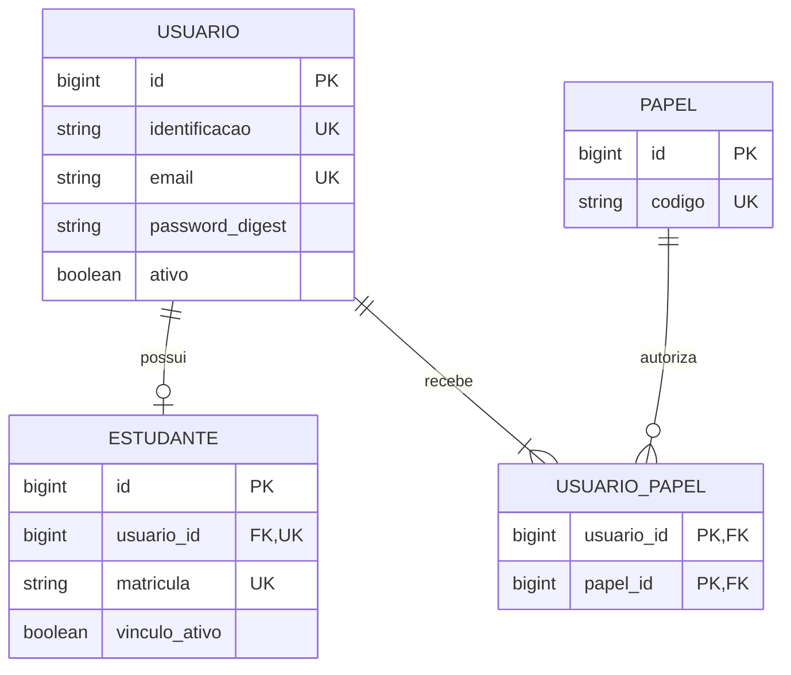
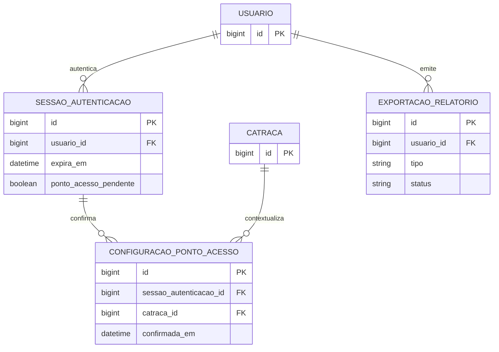
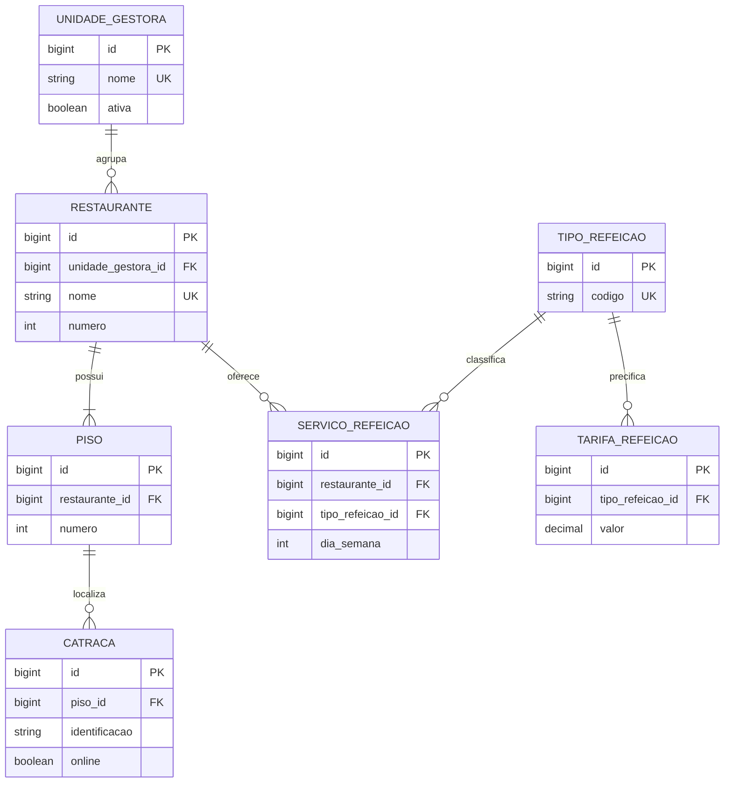
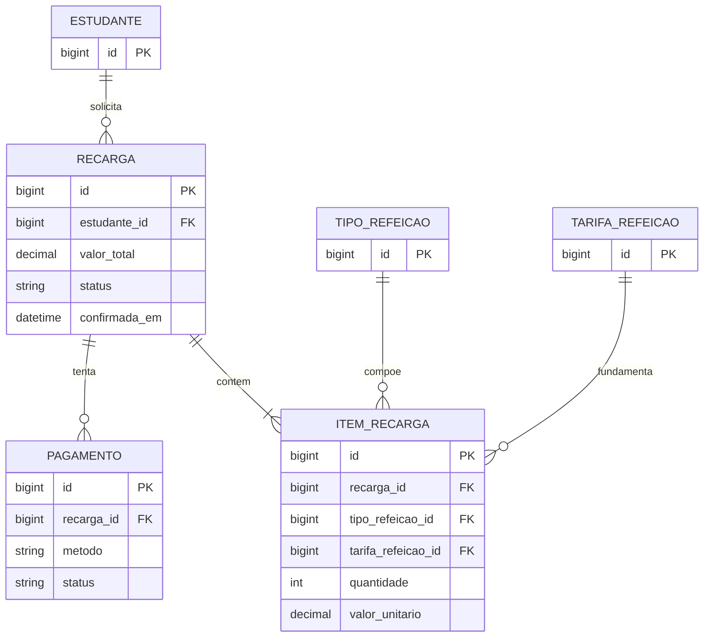
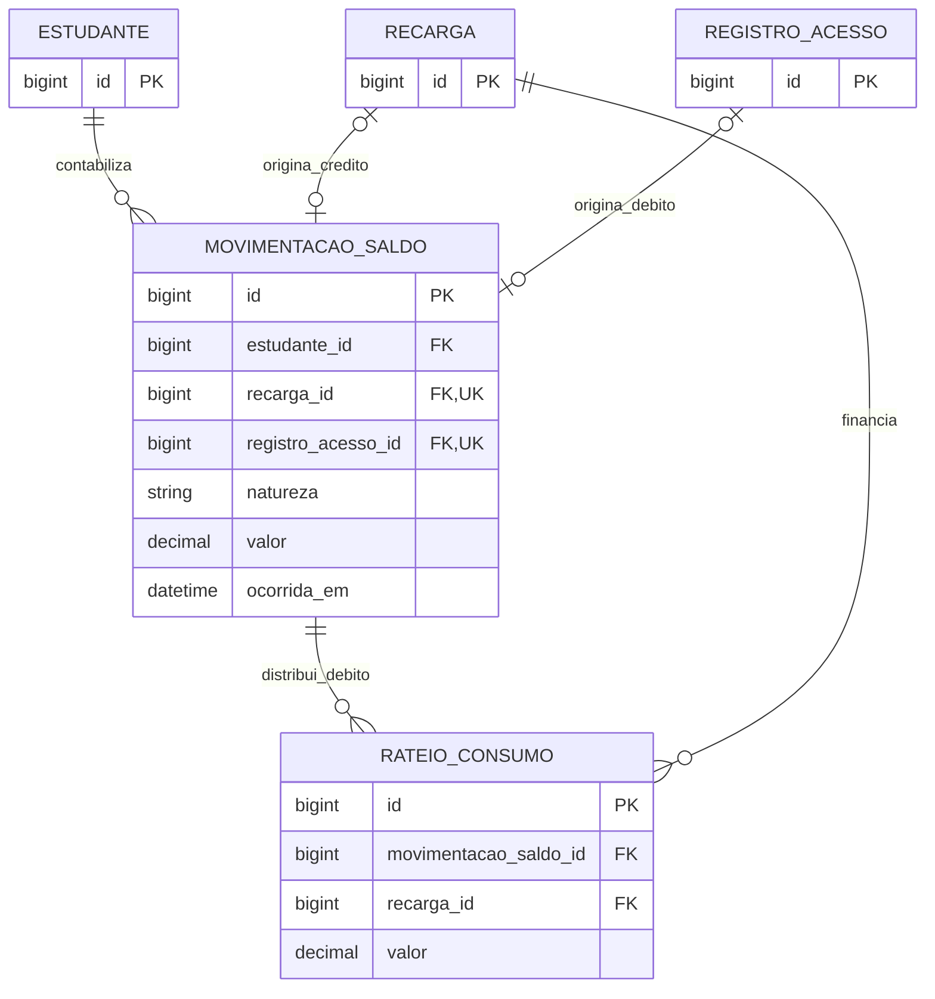
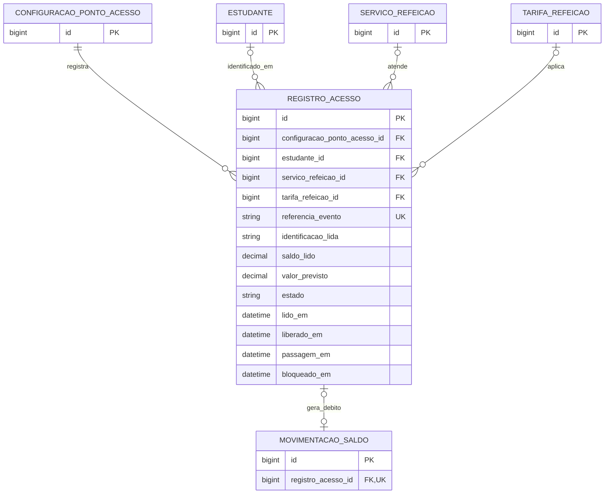
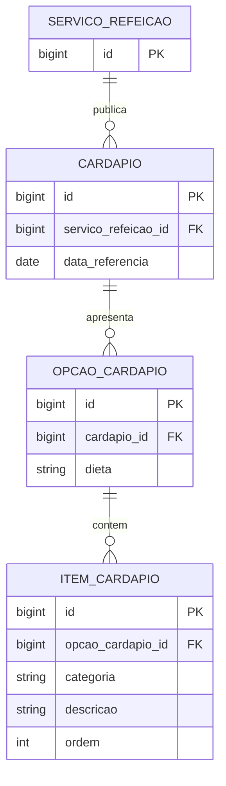

# Introdução

O UnB RU é um sistema de gerenciamento do Restaurante Universitário da Universidade de Brasília. O domínio reúne a conta do estudante, a compra de créditos, a operação de catracas, a gestão de restaurantes, a consulta de cardápios e a produção de relatórios para estudantes e administradores. Este relatório apresenta um modelo entidade-relacionamento lógico, com indicação de chaves e restrições para sua futura implementação em Ruby on Rails e banco relacional.

O documento segue as seções do template `ER-MyRottenPotatoes.tex`, disponibilizado em `TemplateRelatorioSprint1_1`: Introdução, Entidades Principais, Modelo Relacional UML e Considerações Finais. O diagrama utiliza a notação ER de pé de galinha, em vez da notação de classes UML do exemplo, conforme a possibilidade de utilizar Mermaid indicada no enunciado. Os apêndices detalham integridade, rastreabilidade e a investigação técnica das views em Rails.

| Integrante | Matrícula | Papel na sprint |
|:---|:---|:---|
| Daniel Dezan Baby | 232046097 | Scrum Master |
| Leonardo Tome Sampaio | 222005448 | Product Owner |
| Luis Eduardo Curi Serra | 251033574 | Desenvolvedor |
| Tarsila Marques de Oliveira Alves | 242012029 | Desenvolvedora |
| Weldo Gonçalves da Silva Junior | 222014133 | Desenvolvedor |

**Base de requisitos.** Foram analisados os 12 arquivos em `features/`, a wiki do projeto, o arquivo `cardapio.json` e o enunciado `sprint1.pdf`. As referências F01 a F12 correspondem à numeração utilizada na wiki. O relatório descreve uma proposta de modelagem: as tabelas e os serviços aqui especificados ainda não constituem uma aplicação implementada.

**Limites e premissas.** Os requisitos especificam comportamentos, mas não resolvem todas as decisões de persistência. A separação de perfis, a política de consumo de créditos, o armazenamento de auditoria de exportações e o tratamento de concorrência são decisões propostas neste relatório e identificadas como tais. Os preços presentes nos cenários são dados de teste; o modelo mantém tarifas e valores históricos, sem escolher uma tarifa definitiva.

# Entidades Principais

## Convenções do modelo

Todas as entidades possuem `id` como chave primária do tipo `bigint`, exceto `UsuarioPapel`, cuja chave é o par de chaves estrangeiras. O sufixo `_id` identifica uma FK. As tabelas recebem os campos técnicos `created_at` e `updated_at` quando aplicáveis; eles não substituem os horários de negócio, como confirmação do pagamento e passagem na catraca.

Valores monetários usam `decimal(12,2)`, nunca ponto flutuante. Matrículas e identificações são textos, preservando zeros à esquerda. Datas e horas de eventos são armazenadas com referência temporal inequívoca em UTC e exibidas no fuso `America/Sao_Paulo`. Intervalos de datas do usuário incluem o primeiro e o último dia; sua consulta utiliza o início do primeiro dia até, sem incluir, o início do dia posterior ao último.

Nos atributos abaixo, **obrigatório** significa `NOT NULL`; **opcional** significa que `NULL` é permitido. A descrição de uma unicidade composta aplica-se à combinação dos campos. As entidades de apoio ampliam o modelo para atender aos cenários de erro e à auditoria, além dos fluxos felizes.

## 1. Usuario — identidade e credenciais

Centraliza os dados de autenticação de estudantes, funcionários e administradores, evitando credenciais duplicadas para uma pessoa com mais de um perfil.

- `id`: PK.
- `nome`: texto obrigatório, utilizado na identificação de relatórios e da conta.
- `identificacao`: texto obrigatório e único; login de funcionário sem impor formato numérico, conforme F04.
- `email`: texto obrigatório, normalizado e único sem diferenciar maiúsculas de minúsculas.
- `password_digest`: texto obrigatório contendo o hash da senha; a senha em texto não é persistida.
- `ativo`: booleano obrigatório; conta inativa não cria uma sessão válida.

**Relacionamentos:** um usuário possui zero ou um cadastro de estudante, zero ou muitas sessões, zero ou muitas emissões de relatório e um ou mais papéis associados após a conclusão do cadastro.

**Regras atendidas:** F01 e F04. O cadastro público cria somente o papel de estudante. A validação de domínio institucional aplica-se ao cadastro estudantil, sem inventar uma exigência equivalente para funcionários. O conjunto exato de domínios aceitos e a consulta que confirma vínculo ativo com a UnB precisam ser definidos pela equipe.

## 2. Papel — permissões por perfil

- `id`: PK.
- `codigo`: texto obrigatório e único, com os valores propostos `estudante`, `funcionario`, `administrador` e `administrador_geral`.
- `descricao`: texto obrigatório que explica o conjunto de permissões.

**Relacionamento:** um papel pode estar associado a nenhum ou muitos usuários por `UsuarioPapel`.

**Decisão proposta:** permitir múltiplos papéis evita interpretar uma conta exclusivamente estudantil como conta de funcionário. O administrador geral pode consultar o relatório administrativo e tem a permissão específica de F12. A atribuição de papéis é administrativa e não pode ser recebida do formulário de cadastro público.

## 3. UsuarioPapel — associação de autorização

- `usuario_id`: FK obrigatória para `Usuario`.
- `papel_id`: FK obrigatória para `Papel`.
- Chave primária composta por `(usuario_id, papel_id)`.

**Relacionamento:** resolve a associação N:N entre usuários e papéis, impedindo a atribuição duplicada do mesmo papel. A existência do cadastro de estudante deve ser coerente com o papel estudantil.

## 4. Estudante — vínculo universitário e conta

- `id`: PK.
- `usuario_id`: FK obrigatória e única para `Usuario`.
- `matricula`: texto obrigatório e único, com exatamente nove dígitos.
- `vinculo_ativo`: booleano obrigatório, resultante da validação do vínculo universitário.

**Relacionamentos:** cada estudante pertence a um usuário e pode possuir muitas recargas, leituras de identificação e movimentações financeiras.

**Saldo:** é calculado pela soma dos valores assinados de `MovimentacaoSaldo`. Uma conta nova tem saldo zero. Não existe uma segunda coluna de saldo independente neste modelo; uma futura otimização com saldo armazenado deve manter reconciliação com o extrato. Isso evita atualizar o saldo por uma cobrança ainda pendente.

## 5. SessaoAutenticacao — validade do acesso

- `id`: PK; `usuario_id`: FK obrigatória para `Usuario`.
- `token_digest`: texto obrigatório e único, representando um identificador de sessão sem armazenar o token utilizável.
- `autenticada_em` e `expira_em`: instantes obrigatórios, com expiração posterior à autenticação.
- `encerrada_em`: instante opcional; preenchido em logout ou revogação.
- `ponto_acesso_pendente`: booleano obrigatório, inicialmente verdadeiro na aplicação de controle.

**Relacionamentos:** uma sessão pertence a um usuário e possui zero ou muitas configurações confirmadas de ponto de acesso. Somente uma configuração pode estar vigente por sessão.

**Regras atendidas:** F04 e F05. Uma sessão é válida se não foi encerrada, não expirou e o usuário permanece ativo. O prazo de expiração não foi definido pelos cenários e permanece configurável. A reconfiguração pendente bloqueia operações mesmo que a configuração anterior ainda exista para auditoria.

## 6. ConfiguracaoPontoAcesso — contexto confirmado de operação

- `id`: PK; `sessao_autenticacao_id`: FK obrigatória para `SessaoAutenticacao`.
- `catraca_id`: FK obrigatória para `Catraca`.
- `confirmada_em`: instante obrigatório da confirmação válida.
- `finalizada_em`: instante opcional; quando preenchido, deve ser posterior ou igual à confirmação.

**Relacionamentos:** cada configuração pertence a uma sessão e a uma catraca; pode originar muitos registros de acesso. O funcionário é obtido pela sessão; o restaurante, pela catraca e seu piso.

**Regras atendidas:** F05 e F07. A escolha feita no formulário ainda não é uma configuração confirmada. Uma troca válida finaliza a configuração anterior e cria outra, sem reatribuir acessos antigos. Uma tentativa inválida não cria configuração nem substitui a anterior. Logout ou expiração tornam o contexto inutilizável, preservando seus registros de auditoria.

## 7. UnidadeGestora — agrupamento administrativo

- `id`: PK.
- `nome`: texto obrigatório e único.
- `ativa`: booleano obrigatório.

**Relacionamento:** uma unidade gestora possui zero ou muitos restaurantes; cada restaurante pertence a exatamente uma unidade. Permite o filtro de F09. “Campus Darcy Ribeiro” é a unidade padrão prevista na feature, identificada por cadastro, sem fixar seu ID no código.

## 8. Restaurante — unidade de atendimento

- `id`: PK; `unidade_gestora_id`: FK obrigatória para `UnidadeGestora`.
- `nome`: texto obrigatório, único no sistema segundo a validação de nome existente de F08.
- `numero`: inteiro obrigatório, positivo e único na unidade gestora; determina a ordenação de F09.
- `capacidade_refeicoes_hora`: inteiro obrigatório e maior que zero.
- `ativo`: booleano obrigatório.

**Relacionamentos:** cada restaurante possui um ou muitos pisos e zero ou muitos serviços de refeição. A quantidade de pisos é obtida pelos seus registros, evitando mantê-la duplicada.

**Regras atendidas:** F05, F08 e F09. A criação dos pisos e do restaurante é atômica. Não se pode remover um restaurante com catracas associadas; vínculos históricos também impedem exclusão física. Para cadastros com histórico, a proposta é desativar e preservar as referências. Essa política complementa os cenários e deve ser validada pelo grupo.

## 9. Piso — localização física

- `id`: PK; `restaurante_id`: FK obrigatória para `Restaurante`.
- `numero`: inteiro obrigatório e positivo.
- Unicidade composta `(restaurante_id, numero)`.

**Relacionamento:** um piso pertence a um restaurante e pode possuir zero ou muitas catracas. A seleção de um piso inexistente é rejeitada em F08. O piso não muda de restaurante depois de ser referenciado por uma catraca com histórico.

## 10. Catraca — equipamento de controle

- `id`: PK; `piso_id`: FK obrigatória para `Piso`.
- `identificacao`: texto obrigatório, como “Catraca 01” ou “CAT-01”.
- `ativa`: booleano obrigatório; permite desativação administrativa.
- `online`: booleano obrigatório; representa o estado operacional conhecido.
- `estado_verificado_em`: instante opcional da última verificação de conectividade.

**Relacionamentos:** cada catraca pertence a um piso e pode participar de muitas configurações de ponto de acesso. Os acessos históricos são encontrados pelas configurações.

**Unicidade:** a identificação é única por restaurante, inclusive entre pisos distintos. Uma validação de serviço deve consultar o restaurante do piso; em PostgreSQL, a garantia concorrente pode usar um gatilho que serialize cadastros pela linha do restaurante. Um índice apenas em `(piso_id, identificacao)` seria insuficiente para o cenário de identificação repetida em outro piso do mesmo restaurante.

**Regras atendidas:** F05, F07, F08 e F09. `ativa` e `online` representam conceitos distintos. Uma catraca em operação não pode ser removida; considera-se em operação a configuração vigente de uma sessão válida. Movê-la entre restaurantes com histórico é proibido nesta proposta, preservando o vínculo original dos registros.

## 11. TipoRefeicao — classificação do serviço

- `id`: PK.
- `codigo`: texto obrigatório e único: `cafe_da_manha`, `almoco` ou `jantar`.
- `nome`: texto obrigatório para exibição.

**Relacionamentos:** um tipo de refeição pode ter muitos serviços, tarifas e itens de recarga.

**Regras atendidas:** F02, F06, F09 e F10. Almoço e jantar permanecem tipos distintos para relatórios e horários. A interface pode oferecer um pacote “Almoço/Jantar”; nesta proposta, a compra resulta em crédito monetário, conforme o saldo descrito nos cenários. Não se presume um saldo de tickets restrito por tipo de refeição.

## 12. TarifaRefeicao — preço com vigência

- `id`: PK; `tipo_refeicao_id`: FK obrigatória para `TipoRefeicao`.
- `valor`: decimal obrigatório, maior que zero.
- `vigente_desde`: instante obrigatório; `vigente_ate`: instante opcional, posterior ao início quando informado.

**Relacionamentos:** uma tarifa pode ser utilizada por muitos itens de recarga e registros de acesso. Para um tipo, duas vigências não podem se sobrepor; o intervalo é fechado no início e aberto no fim.

**Decisão proposta:** a tarifa é institucional por tipo, pois F02 não escolhe restaurante para comprar créditos. Caso a equipe defina preços por restaurante ou categoria de estudante, o escopo tarifário precisará ser ampliado. O valor aplicado é copiado para o item ou acesso; alterar uma tarifa futura não recalcula transações passadas.

## 13. ServicoRefeicao — agenda de atendimento

- `id`: PK; `restaurante_id`: FK obrigatória para `Restaurante`; `tipo_refeicao_id`: FK obrigatória para `TipoRefeicao`.
- `dia_semana`: inteiro obrigatório de 0 a 6, com domingo igual a 0.
- `inicio` e `fim`: horários locais obrigatórios, com início anterior ao fim.
- `ativo`: booleano obrigatório.
- Unicidade composta `(restaurante_id, tipo_refeicao_id, dia_semana)`.

**Relacionamentos:** um serviço pode possuir muitos cardápios datados e muitos registros de acesso. Os horários de um restaurante no mesmo dia não podem se sobrepor.

**Regras atendidas:** F06 e F10. A refeição atual é determinada pelo restaurante, dia da semana e horário, usando início inclusivo e fim exclusivo. Os horários reais não estão definidos no material local; não são inventados como regra definitiva. Serviços que atravessem a meia-noite exigiriam extensão do modelo.

## 14. Recarga — pedido de compra de crédito

- `id`: PK; `estudante_id`: FK obrigatória para `Estudante`.
- `solicitada_em`: instante obrigatório.
- `valor_total`: decimal obrigatório e maior que zero, igual à soma dos itens.
- `status`: texto obrigatório: `pendente`, `confirmada`, `expirada` ou `cancelada`.
- `confirmada_em`: instante opcional, obrigatório apenas para recarga confirmada.

**Relacionamentos:** cada recarga possui um ou muitos itens e zero ou muitas tentativas de pagamento. Produz no máximo uma movimentação de crédito. Pode financiar muitos débitos por meio de rateios.

**Regras atendidas:** F02 e F03. O pedido e seus itens são salvos em uma transação. Um formulário com quantidades zeradas não produz pedido válido nem cobrança. A confirmação financeira é diferente da solicitação do estudante.

## 15. ItemRecarga — composição e preço da compra

- `id`: PK; `recarga_id`: FK obrigatória para `Recarga`.
- `tipo_refeicao_id`: FK obrigatória para `TipoRefeicao`; `tarifa_refeicao_id`: FK obrigatória para `TarifaRefeicao`.
- `quantidade`: inteiro obrigatório e maior que zero.
- `valor_unitario`: decimal obrigatório e maior que zero, preservado no momento da compra.
- Unicidade composta `(recarga_id, tipo_refeicao_id)`.

**Relacionamento:** cada item pertence a um pedido e referencia o tipo e a tarifa utilizados. O tipo da tarifa deve ser o mesmo do item. Subtotal é `quantidade × valor_unitario`; não requer coluna independente.

**Exemplo de F02:** cinco cafés a R$ 2,50 e dez almoços/jantares a R$ 4,50 totalizam R$ 57,50. A categoria agrupada da interface deve ser convertida de maneira documentada para os itens internos; o crédito final é monetário e não impede seu uso no jantar.

## 16. Pagamento — tentativa e confirmação pelo provedor

- `id`: PK; `recarga_id`: FK obrigatória para `Recarga`.
- `metodo`: texto obrigatório: `pix` ou `cartao_credito`, métodos aceitos por F02.
- `status`: texto obrigatório: `pendente`, `confirmado`, `recusado` ou `expirado`.
- `referencia_provedor`: texto opcional, único quando informado; torna-se obrigatório quando a cobrança é emitida no provedor.
- `valor_solicitado`: decimal obrigatório e positivo; deve coincidir com o pedido.
- `valor_confirmado`: decimal opcional; obrigatório e igual ao solicitado na confirmação válida.
- `criado_em`: instante obrigatório; `expira_em` e `confirmado_em`: instantes opcionais conforme método e estado.
- `pix_copia_cola`: texto opcional; preenchido quando o PIX é emitido. O QR Code pode ser renderizado a partir desse conteúdo.

**Relacionamento:** um pedido pode ter mais de uma tentativa, mas somente uma confirmação aceita. Um índice único parcial em `recarga_id` para `status = 'confirmado'` impede dois pagamentos confirmados para o mesmo pedido. A referência do provedor identifica notificações repetidas.

**Regras atendidas:** F02 e F09. O PIX expira dez minutos após a criação da cobrança. A confirmação deve ser verificada no servidor, não deduzida do cronômetro ou do retorno visual do navegador. Não se armazenam número completo do cartão ou CVV. A reação a um pagamento efetivamente recebido depois da expiração necessita definição do provedor e da equipe; não se credita silenciosamente uma cobrança expirada.

## 17. RegistroAcesso — toda leitura na catraca

- `id`: PK.
- `configuracao_ponto_acesso_id`: FK obrigatória para o contexto confirmado da operação.
- `estudante_id`: FK opcional para `Estudante`, ausente em leitura desconhecida.
- `servico_refeicao_id` e `tarifa_refeicao_id`: FKs opcionais; obrigatórias para autorização válida de uma refeição.
- `identificacao_lida`: texto obrigatório, admitindo texto vazio para auditar a leitura inválida.
- `lido_em`: instante obrigatório da leitura; `saldo_lido`: decimal opcional, ausente para identificação desconhecida.
- `valor_previsto`: decimal opcional, positivo quando a tarifa foi identificada.
- `estado`: texto obrigatório: `negado`, `aguardando_passagem`, `realizado` ou `expirado`.
- `motivo_negacao`: texto opcional, obrigatório no estado `negado`.
- `liberado_em`, `passagem_em` e `bloqueado_em`: instantes opcionais, sujeitos às regras de estado.
- `referencia_evento`: texto obrigatório e único, utilizado para reconhecer repetição de eventos do equipamento.

**Relacionamentos:** cada leitura pertence a um contexto confirmado. Pode referenciar um estudante, um serviço e uma tarifa. Uma passagem realizada possui exatamente uma movimentação de débito; as demais leituras não possuem débito.

**Regras atendidas:** F06 e F07. `catraca_liberada = S` deriva de `liberado_em` preenchido; `acesso_realizado = S` deriva de `estado = realizado`. Essas projeções reproduzem os campos exigidos pelo histórico, sem manter booleanos redundantes que possam contradizer os timestamps. O saldo lido é uma fotografia e não o saldo atual recalculado posteriormente.

## 18. MovimentacaoSaldo — extrato financeiro definitivo

- `id`: PK; `estudante_id`: FK obrigatória para `Estudante`.
- `recarga_id`: FK opcional e única para `Recarga`.
- `registro_acesso_id`: FK opcional e única para `RegistroAcesso`.
- `natureza`: texto obrigatório: `credito_recarga` ou `debito_refeicao`.
- `valor`: decimal obrigatório, positivo no crédito e negativo no débito.
- `ocorrida_em`: instante obrigatório, igual à confirmação do crédito ou à passagem da refeição.

**Relacionamentos:** uma movimentação pertence a um estudante e possui exatamente uma origem: recarga ou acesso. Um débito pode ser dividido em muitos rateios de consumo.

**Regras atendidas:** F02, F03, F06 e F11. Um `CHECK` garante a exclusividade das origens e a coerência entre natureza e sinal. Créditos exigem recarga confirmada; débitos exigem acesso realizado. O estudante da movimentação deve coincidir com o estudante da origem. Não se apagam lançamentos para alterar saldo. Estornos e chargebacks exigiriam novos tipos de lançamento e não foram especificados nesta sprint.

## 19. RateioConsumo — origem dos recursos de uma refeição

- `id`: PK; `movimentacao_saldo_id`: FK obrigatória para uma movimentação de débito.
- `recarga_id`: FK obrigatória para uma recarga confirmada do mesmo estudante.
- `valor`: decimal obrigatório e maior que zero.
- Unicidade composta `(movimentacao_saldo_id, recarga_id)`.

**Relacionamentos:** uma recarga pode financiar muitos débitos e um débito pode consumir recursos de muitas recargas. A associação N:N é resolvida por esta entidade.

**Decisão proposta para F09:** consumir créditos confirmados mais antigos primeiro, pelo critério FIFO. A soma dos rateios de um débito deve ser igual ao seu valor absoluto; a soma consumida de uma recarga não pode exceder seu crédito. Isso permite atribuir uma refeição ao PIX e/ou ao cartão de origem, mesmo quando a recarga ocorreu em outra data. Somar recargas do dia e chamar o resultado de arrecadação das refeições do dia produziria números incorretos.

## 20. Cardapio — publicação por data e serviço

- `id`: PK; `servico_refeicao_id`: FK obrigatória para `ServicoRefeicao`.
- `data_referencia`: data obrigatória, cujo dia da semana deve coincidir com o serviço.
- Unicidade composta `(servico_refeicao_id, data_referencia)`.

**Relacionamento:** cada cardápio pertence a um serviço em uma data e possui zero ou muitas opções de dieta. Um cardápio não é a refeição consumida; é a informação disponibilizada ao estudante.

**Regras atendidas:** F10. O JSON semanal existente pode fornecer dados iniciais para uma semana selecionada, gerando publicações datadas. Não se presume que o mesmo cardápio se repita indefinidamente nem que o arquivo contenha horários de funcionamento.

## 21. OpcaoCardapio — alternativa alimentar

- `id`: PK; `cardapio_id`: FK obrigatória para `Cardapio`.
- `dieta`: texto obrigatório: `padrao`, `ovolactovegetariana` ou `vegetariana_estrita`.
- Unicidade composta `(cardapio_id, dieta)`.

**Relacionamento:** cada opção possui zero ou muitos itens. A opção ausente ou sem itens deve ser apresentada como indisponível, conforme F10. Os demais grupos continuam visíveis.

## 22. ItemCardapio — composição da opção

- `id`: PK; `opcao_cardapio_id`: FK obrigatória para `OpcaoCardapio`.
- `categoria`: texto obrigatório, como bebida, salada, prato principal, acompanhamento ou sobremesa.
- `descricao`: texto obrigatório e não vazio.
- `ordem`: inteiro obrigatório e positivo, único dentro da opção.

**Relacionamento:** um item pertence a exatamente uma opção alimentar. A importação do JSON distribui itens comuns entre as opções e associa os complementos/pratos específicos à dieta correspondente. Campo `null` ou lista vazia não deve gerar item de texto vazio.

## 23. ExportacaoRelatorio — emissão e contexto da auditoria

- `id`: PK; `usuario_id`: FK obrigatória para o emissor.
- `tipo`: texto obrigatório: `extrato_estudante` ou `operacao_global`.
- `formato`: texto obrigatório: `pdf` ou `csv`, respeitando a disponibilidade de cada feature.
- `filtros` e `agrupamentos`: objetos JSON obrigatórios, com estrutura validada para cada relatório.
- `solicitada_em`: instante obrigatório; `emitida_em`: instante opcional.
- `status`: texto obrigatório: `processando`, `concluida`, `sem_dados` ou `falhou`.
- `quantidade_registros`: inteiro opcional e não negativo; `total_debitos` e `total_creditos`: decimais opcionais e não negativos.
- `arquivo_chave` e `arquivo_sha256`: textos opcionais; somente preenchidos após geração completa.
- `assinatura_status`: texto obrigatório: `nao_aplicavel`, `pendente`, `assinada` ou `falhou`.

**Relacionamento:** uma emissão pertence a um usuário. O estudante de F11 é derivado do usuário autenticado, nunca escolhido livremente em um filtro recebido do navegador.

**Decisão proposta para F09, F11 e F12:** persistir metadados de emissão permite explicar quem exportou, quando, com quais filtros e agrupamentos. Os dados do documento devem ser obtidos de uma consulta consistente, incluindo todas as páginas, e o arquivo final é identificado por hash. O hash detecta alteração do arquivo, mas não é assinatura digital. A assinatura exigida no cenário de F11 requer mecanismo criptográfico e certificado a definir; o documento não pode ser rotulado como assinado antes desse processo.

# Modelo Relacional UML

A visão geral apresenta o esquema completo em um único diagrama, com as 23 entidades, todos os atributos do dicionário e os 30 relacionamentos; como a figura é vetorial, seus detalhes podem ser ampliados no PDF. Para manter a legibilidade, o mesmo esquema é detalhado em sete visões parciais. Entidades repetidas entre as figuras representam as mesmas tabelas. As visões parciais exibem chaves e atributos centrais; o dicionário anterior define os demais atributos e restrições.

**Legenda:** `||` significa exatamente um; `o|`, zero ou um; `o{`, zero ou muitos; `|{`, um ou muitos. `PK` indica chave primária, `FK` chave estrangeira e `UK` chave única. Na visão geral, a última coluna das entidades anota unicidades compostas ou parciais e restrições entre relacionamentos que a cardinalidade não expressa, como o XOR entre as origens de uma movimentação. As relações opcionais entre acesso, tarifa e estudante permitem registrar leituras rejeitadas sem inventar um estudante válido. As condições entre estado e existência de registros são detalhadas no Apêndice A.

## Visão geral — Modelo completo


## Visão 1 — Identidade e papéis



## Visão 2 — Sessão, ponto de acesso e emissão



## Visão 3 — Estrutura física e oferta de refeições



## Visão 4 — Compra e pagamento



## Visão 5 — Extrato e origem dos recursos consumidos



## Visão 6 — Leitura, autorização e passagem



## Visão 7 — Cardápios e alternativas alimentares



## Normalização e preservação histórica

Cada movimentação tem exatamente uma das duas origens opcionais representadas na visão financeira. A notação não expressa essa exclusividade; ela é garantida pela restrição XOR descrita no Apêndice A. Uma recarga origina no máximo um crédito; uma movimentação de débito não possui recarga como origem direta, embora possa consumir suas reservas por rateios.

As informações cadastrais são separadas de eventos e movimentos financeiros. Restaurante não é repetido como FK na catraca porque já é determinado pelo piso. Funcionário não é repetido no acesso porque é determinado pela configuração e sua sessão. A associação de papéis e o rateio financeiro resolvem relações N:N sem listas em uma coluna.

Os itens de recarga, opções de dieta e itens do cardápio evitam grupos repetidos como `item1`, `item2` ou uma coluna por alternativa alimentar. A descrição de um prato permanece texto de apresentação; não se propõe um cadastro de ingredientes ou estoque, ausentes do escopo.

Valores unitários de compra, saldo lido e valor previsto de entrada são fotografias intencionais do evento. Não devem ser substituídos pelo preço ou saldo atuais. Os vínculos que determinam o contexto histórico não podem ser realocados depois de referenciados: não se troca o estudante de uma recarga, o piso histórico de uma catraca, a sessão de uma configuração ou a origem de um lançamento.

Totais do relatório, percentuais, saldo atual, flags de liberação e quantidade de pisos são derivados. Os totais registrados em uma emissão representam o documento emitido, não uma nova fonte de verdade para as operações. JSON é reservado aos parâmetros variáveis de uma emissão; os relacionamentos do domínio continuam representados por FKs.

# Considerações Finais

O modelo proposto cobre as 12 funcionalidades da primeira sprint com 23 entidades. A estrutura distingue solicitação de recarga, confirmação de pagamento, leitura de identificação, autorização temporária e passagem efetiva. Essas distinções permitem representar os caminhos tristes dos cenários sem criar créditos ou débitos indevidos.

A proposta mantém a origem de cada lançamento e o contexto de cada operação, permitindo construir o extrato individual, o histórico local e os relatórios globais a partir de fatos consistentes. A visão geral e as sete visões parciais representam o mesmo esquema; as restrições adicionais complementam cardinalidades que, sozinhas, não expressam regras de estado, tempo e concorrência.

Antes da implementação, o grupo deve decidir os pontos identificados no Apêndice D, especialmente a política de tarifas, o significado financeiro dos métodos de liquidação, o consumo de créditos e a assinatura digital. A investigação de views apresentada no Apêndice C oferece uma direção técnica para a próxima sprint. Sua aderência visual ao protótipo precisa ser conferida no Figma, cujo conteúdo não pôde ser acessado nesta elaboração.

# Apêndice A — Integridade e ciclos de negócio

## A.1 Restrições de banco e de serviço

| Restrição | Garantia proposta |
|:---|:---|
| Identificação, matrícula e email sem duplicação | Índices únicos; normalização de email antes de persistir; matrícula com nove dígitos. |
| Permissões consistentes | PK composta em `UsuarioPapel`; serviço de cadastro cria conta, papel e estudante na mesma transação. |
| Uma configuração vigente por sessão | Índice único parcial em `sessao_autenticacao_id` quando `finalizada_em IS NULL`. |
| Restaurante com pelo menos um piso | Criação/alteração por serviço transacional; impedir exclusão do último piso. |
| Catraca com nome único no restaurante | Validação pelo restaurante do piso, serialização no restaurante e gatilho no banco na implementação PostgreSQL. |
| Preços e horários não ambíguos | Rejeitar vigências tarifárias sobrepostas por tipo e janelas de serviço sobrepostas por restaurante/dia. |
| Pedido de recarga íntegro | Pelo menos um item; quantidade positiva; soma dos subtotais igual ao total. Escrita transacional. |
| Uma confirmação financeira por pedido | Índice único parcial de pagamento confirmado por recarga e índice único da referência externa. |
| Uma origem por lançamento | `CHECK` de natureza, sinal e XOR entre `recarga_id` e `registro_acesso_id`; ambas as FKs com índice único. |
| Valor e titular coerentes com a origem | Serviço transacional e validações entre tabelas, reforçáveis com gatilhos; não são verificáveis apenas por `CHECK` da linha. |
| Débito com financiamento suficiente | Soma dos rateios igual ao débito; soma consumida de cada recarga menor ou igual ao crédito. |
| Acesso coerente com o restaurante | Serviço de refeição deve pertencer ao restaurante da catraca da configuração; tarifa deve ser do tipo do serviço. |
| Eventos repetidos sem cobrança duplicada | Referência única do evento e débito único por acesso; estados terminais não são reprocessados. |
| Preservação histórica | FKs com exclusão restrita para cadastros referenciados; impedir reatribuição dos vínculos históricos. |

As condições sobre somas, períodos e registros relacionados devem ser implementadas em serviços de domínio dentro de transações, com bloqueios consistentes. Validações isoladas de model não protegem de duas requisições simultâneas. Não se apresenta um esquema SQL executável nesta entrega; esta tabela orienta as migrations e os serviços da próxima sprint.

## A.2 Pagamento e atualização do saldo

1. O estudante informa quantidades inteiras não negativas. Itens com quantidade zero são omitidos; se todos forem zero, a solicitação é rejeitada com “Não é possível gerar uma cobrança zerada”.
2. O servidor consulta tarifas vigentes, fixa os valores unitários e calcula o total. Dados de preço enviados pelo navegador não são aceitos como fonte do valor.
3. São criados pedido, itens e tentativa de pagamento. No PIX, a cobrança exibe QR Code e Copia e Cola e tem validade de dez minutos. Até a confirmação, não existe movimentação de crédito.
4. A confirmação autenticada do provedor bloqueia o estudante e a recarga, verifica estado, referência, titularidade e valor e aceita somente uma confirmação para o pedido.
5. A mesma transação confirma pedido/pagamento e grava um único crédito. A repetição da notificação devolve o resultado já registrado.
6. Pagamento recusado ou PIX expirado não gera crédito. Um novo pedido ou uma tentativa válida posterior depende das regras de reemissão definidas na implementação.

**Exemplo:** saldo inicial zero, dois cafés a R$ 2,50 e quatro almoços/jantares a R$ 4,50 produzem pedido de R$ 23,00. Saldo pendente: R$ 0,00; após confirmação: R$ 23,00. Não são seis lançamentos de crédito, mas um crédito e seus itens de composição.

## A.3 Configuração e troca do ponto de acesso

Após login, `ponto_acesso_pendente` é verdadeiro e nenhuma operação dependente do ponto está disponível. O formulário lista restaurantes ativos e catracas do restaurante escolhido. A confirmação revalida disponibilidade e pertencimento; só então cria uma configuração confirmada e desmarca a pendência.

Ao iniciar uma troca, a sessão volta ao estado pendente. Selecionar outro restaurante limpa a catraca apenas no formulário. A configuração anterior continua identificável, mas não autoriza operações durante a pendência. A confirmação válida finaliza a anterior e cria a nova na mesma transação. Erros mantêm a pendência e não geram um evento de configuração concluída.

Logout/expiração invalidam o uso da configuração, mesmo se uma tarefa de limpeza ainda não tiver preenchido seu encerramento. O servidor verifica a validade da sessão em cada operação. O histórico da catraca exige também a validação da credencial do funcionário prevista em F07 e compara a catraca solicitada com o ponto que ele gerencia; autenticar outro funcionário não concede acesso ao histórico local.

## A.4 Estados da leitura e cobrança na passagem

| Estado | Liberação | Passagem | Bloqueio registrado | Efeito financeiro |
|:---|:---|:---|:---|:---|
| `negado` | Não | Não | Sem timestamp de novo comando de bloqueio | Nenhum débito; identificação e motivo são preservados. |
| `aguardando_passagem` | Sim | Ainda não | Não | Nenhum débito; autorização temporária de até cinco segundos. |
| `realizado` | Sim | Sim | No instante da passagem | Um débito do valor previsto e respectivos rateios. |
| `expirado` | Sim | Não | No fim do prazo | Nenhum débito; mensagem “Acesso cancelado”. |

Para a identificação inválida ou desconhecida, `estudante_id` e `saldo_lido` ficam ausentes e a mensagem é “Identificação desconhecida”. Para saldo insuficiente, o estudante e seu saldo lido são preservados, a catraca não é liberada e a mensagem é “Saldo insuficiente”. Quando o saldo é exatamente o preço, o acesso é permitido.

O prazo é contado a partir da liberação, não da leitura. Com leitura às 12:00:00 e liberação às 12:00:01, o bloqueio por expiração ocorre às 12:00:06, como em F07. A tabela de F06 admite passagem após cinco segundos; por isso, propõe-se aceitar um evento de passagem com horário menor ou igual ao limite. Em empate entre passagem e timeout, o processamento precisa comparar o timestamp do evento e serializar a transição. A precisão e a origem confiável do relógio do equipamento devem ser definidas na integração.

**Concorrência proposta:** permitir no máximo uma autorização pendente por estudante e por catraca, com índices únicos parciais para `estado = 'aguardando_passagem'`. Expirações pendentes são resolvidas antes de nova autorização. Isso evita liberar duas catracas para gastar o mesmo saldo. A identificação de uma nova tentativa concorrente e sua mensagem ainda precisam ser especificadas pela equipe.

Na passagem, uma transação bloqueia o estudante e o acesso, revalida o estado e o prazo, cria o débito, distribui os rateios e finaliza o registro. Confirmação de pagamento, autorização, timeout e passagem seguem uma ordem de bloqueios consistente para evitar interbloqueios. Débito e rateio só se tornam visíveis juntos. O comando físico de bloqueio/liberação precisa de confirmação e política de falha de integração; uma transação de banco não garante, sozinha, a execução de um comando no equipamento.

**Exemplo:** saldo lido de R$ 10,00 e tarifa de R$ 2,50. Antes da passagem, saldo financeiro de R$ 10,00. Passagem válida em dois segundos: débito de R$ 2,50, saldo final R$ 7,50 e mensagem “Boa refeição”. Sem passagem no prazo: saldo final R$ 10,00 e registro de autorização expirada.

## A.5 Extratos, relatórios e fórmulas

O extrato estudantil consulta somente `MovimentacaoSaldo` do estudante autenticado. O histórico de refeições contém passagens realizadas; leituras rejeitadas ou expiradas aparecem no histórico operacional da catraca, sem serem apresentadas como refeições cobradas.

| Indicador | Definição proposta |
|:---|:---|
| Saldo atual | Soma de todos os valores assinados do estudante; não apenas do período filtrado. |
| Total recarregado no período | Soma dos créditos confirmados que correspondem aos filtros pertinentes. |
| Total gasto no período | Valor absoluto da soma dos débitos correspondentes ao filtro. |
| Refeições servidas | Quantidade de acessos realizados, com débito correspondente, no escopo consultado. |
| Arrecadação operacional | Soma dos valores efetivamente debitados pelas refeições selecionadas. |
| Total por restaurante | Mesma soma e contagem, agrupadas pelo ID do restaurante da catraca. |
| Distribuição por refeição | Contagem e valores dos acessos realizados, agrupados pelo tipo do serviço. |
| Catracas online | Quantidade `online = true` sobre o total cadastrado na unidade; a inclusão de desativadas requer decisão do grupo. |
| Métodos de liquidação | Soma dos rateios dos débitos filtrados, agrupados pelo método do pagamento confirmado da recarga de origem. |
| Percentual de um método | Valor do método dividido pela arrecadação operacional, vezes 100; zero quando não há arrecadação. |
| Ticket médio | Arrecadação operacional dividida pelo número de refeições servidas; zero sem refeições. |
| Transações validadas | Nesta proposta, quantidade de débitos de refeições no escopo, distinta do número de tentativas de pagamento. |
| Divergências contábeis | Ocorrências de valor de crédito/pagamento inconsistente, débito sem rateio integral ou uso superior ao crédito de origem. |

As fórmulas são propostas de interpretação da tela de F09. Não representam, por si só, conciliação bancária com taxas e datas de liquidação do adquirente. Se esse for o objetivo do painel, será necessária uma entidade própria de liquidação e dados fornecidos pelo provedor.

O relatório começa com hoje, todos os turnos e a unidade Campus Darcy Ribeiro. Os filtros de data, turno, unidade, restaurante e catraca são combinados antes de calcular cards, tabela e painéis. Restaurantes sem acessos permanecem listados com zero; isso exige partir do cadastro de restaurantes e agregar os resultados filtrados sem excluí-los por um filtro aplicado incorretamente sobre um `LEFT JOIN`.

O total consolidado soma as linhas por restaurante. Não se multiplica toda a contagem do restaurante por uma tarifa única quando há refeições com preços diferentes. O agrupamento de catracas utiliza IDs e o vínculo com o restaurante, pois duas catracas podem ter o mesmo nome em restaurantes distintos. A interface é somente leitura; não existe edição de acesso pelo relatório.

**Exemplo de origem dos recursos:** uma refeição de R$ 4,50 pode consumir R$ 2,00 de uma recarga PIX e R$ 2,50 de uma recarga no cartão. Os rateios atribuem exatamente esses valores aos métodos. As recargas podem ser de dias anteriores. A soma por método continua igual ao débito do período, sem somar novamente o crédito recebido.

## A.6 Exportação, autorização e integridade do arquivo

F11 utiliza o mesmo escopo de dados da conta autenticada. Os filtros de refeição e catraca reduzem os lançamentos; recargas sem catraca não devem ser atribuídas artificialmente a um restaurante. A feature mostra que filtrar “Almoço” exclui a recarga do extrato. Já o saldo atual permanece sendo o saldo da conta, independentemente do filtro.

F12 exige administrador geral com sessão válida. O PDF inclui data/hora da passagem, matrícula, restaurante, catraca, refeição, valor debitado, total de acessos, total debitado, emissor, horário de emissão, filtros e agrupamentos. O agrupamento mantém subtotais por restaurante e catraca. F09 também prevê CSV e PDF consolidado; a distinção de permissões para a exportação oficial é um ponto de alinhamento entre as features.

As exportações usam a consulta filtrada antes da paginação. Um período invertido é rejeitado antes da geração. Sem dados, não há arquivo; o estado de emissão pode registrar `sem_dados`. Falha de renderização mantém `arquivo_chave` ausente, informa o erro e permite nova tentativa. Falha de exportação não altera acessos, saldos nem pagamentos.

O processamento assíncrono precisa autorizar a solicitação, fixar um conjunto consistente de dados para a emissão e revalidar a permissão no download. Credenciais expiradas não são contornadas por uma URL pública permanente. A escolha do gerador de PDF, do armazenamento e da assinatura deve ser validada na implementação.

## A.7 Cardápio atual e transformação do JSON

O serviço atual é encontrado por restaurante, dia da semana e horário local. Sem serviço em andamento, exibe-se ausência de cardápio atual; com serviço e sem publicação, informa-se indisponibilidade para a data. O estudante deve conseguir distinguir esse estado de uma única dieta sem itens.

O arquivo `cardapio.json` organiza a semana em `cafe_da_manha`, `almoco` e `jantar`, com campos comuns e específicos de dieta. A importação proposta cria o cardápio por serviço/data e as três opções alimentares, copia bebidas, frutas e acompanhamentos comuns para cada opção e encaminha `complemento_*` e `prato_principal_*` à dieta adequada. Valores opcionais ausentes são ignorados. As categorias e a ordem preservam a apresentação dos itens.

O JSON não contém o restaurante, a semana de validade nem os horários. Esses dados devem ser fornecidos na importação e na configuração dos serviços; não podem ser inferidos como fatos do arquivo.

# Apêndice B — Rastreabilidade com as features

| Feature e arquivo | Entidades e consultas | Cenários e restrições representados |
|:---|:---|:---|
| F01 — `cadastro_usuario.feature` | Usuario, Papel, UsuarioPapel, Estudante | Matrícula de nove dígitos, domínio institucional e senha mínima de oito caracteres; cadastro inválido não cria conta parcial. |
| F02 — `recarga_saldo.feature` | Recarga, ItemRecarga, TarifaRefeicao, Pagamento, MovimentacaoSaldo | Soma de quantidades e preços; PIX/Copia e Cola; expiração em dez minutos; cartão recusado e PIX pendente não geram crédito; pedido zerado é rejeitado. |
| F03 — `extrato_historico.feature` | Estudante, MovimentacaoSaldo, RegistroAcesso | Saldo, recargas e passagens da própria conta; extrato vazio; negação de acesso ao extrato alheio. |
| F04 — `autenticacao_funcionario.feature` | Usuario, Papel, UsuarioPapel, SessaoAutenticacao | Atividade, credenciais obrigatórias, login válido, senha errada, perfil estudantil exclusivo, logout e sessão expirada. |
| F05 — `configuracao_ponto_acesso.feature` | SessaoAutenticacao, ConfiguracaoPontoAcesso, Restaurante, Piso, Catraca | Seleção dependente, pertencimento, revalidação, troca pendente, rejeição sem substituir contexto e preservação dos registros anteriores. |
| F06 — `validacao_entrada.feature` | RegistroAcesso, Estudante, ServicoRefeicao, TarifaRefeicao, MovimentacaoSaldo | Identificação desconhecida, saldo insuficiente/exato, liberação sem débito, passagem com débito único e timeout sem cobrança. |
| F07 — `historico_local_catraca.feature` | Usuario, SessaoAutenticacao, ConfiguracaoPontoAcesso, RegistroAcesso | Credencial e catraca gerenciada, isolamento de registros, histórico vazio, saldo lido, flags e timestamps, inclusive leituras inválidas. |
| F08 — `gestao_restaurante_catracas.feature` | UnidadeGestora, Restaurante, Piso, Catraca | Cadastro/edição, pisos e capacidade positivos, nome duplicado, catraca repetida entre pisos, exclusão com dependências e catraca em operação. |
| F09 — `relatorio_global_acesso.feature` | Estrutura física, RegistroAcesso, MovimentacaoSaldo, RateioConsumo, Pagamento, ExportacaoRelatorio | Perfil administrativo, filtros conjuntos, totais, online, restaurantes zerados, métodos, CSV/PDF e consulta sem resultados. |
| F10 — `cardapio_atual.feature` | ServicoRefeicao, Cardapio, OpcaoCardapio, ItemCardapio | Refeição atual, três dietas, ausência de serviço e opção sem itens. |
| F11 — `exportacao_PDF_historico_estudante.feature` | Usuario, Estudante, MovimentacaoSaldo, RegistroAcesso, ExportacaoRelatorio | Titularidade, filtros, saldo e totais, identificação, período, sem lançamentos, sessão expirada e assinatura digital a implementar. |
| F12 — `exportacao_pdf_relatorio_operacao.feature` | RegistroAcesso, ConfiguracaoPontoAcesso, MovimentacaoSaldo, ExportacaoRelatorio | Período inclusivo, filtros por unidade física, subtotais, emissor, exportação integral com paginação, acesso direto, ausência de dados e erro sem arquivo parcial. |

# Apêndice C — Spike: implementação das views em Rails

## C.1 Pergunta, método e resultado

**Pergunta:** como transformar as telas do protótipo UnB RU em views Rails, preservando os fluxos e estados das 12 features sem concentrar regras financeiras ou de autorização no navegador?

**Investigação realizada:** leitura dos cenários e da wiki, identificação dos componentes e estados necessários e consulta à documentação oficial de Action View, formulários, Turbo, Stimulus e bloqueios transacionais. O link do Figma foi extraído do PDF, mas seu conteúdo não foi acessível pela consulta web. O plugin Figma foi localizado, porém não estava conectado nesta sessão. Assim, o mapeamento abaixo deriva das features; cores, tipografia, espaçamento, ícones e fidelidade dos frames ainda não foram verificados.

**Resultado:** propõe-se Rails com templates ERB, layouts por área e partials compartilhados. `form_with` atende cadastros e filtros; Turbo Frames permite atualizar partes das páginas; Stimulus atende comportamentos locais, como quantidades, cópia do PIX e seleção dependente. A solução foi investigada documentalmente; não foi executada uma aplicação Rails ou comprovada integração com equipamentos, pagamentos ou assinatura.

## C.2 Organização das telas

| Área/tela | Views propostas | Componentes e estados relevantes |
|:---|:---|:---|
| Cadastro do estudante | `cadastros/new.html.erb` | Matrícula, email, senha, erros por campo, envio em andamento e sucesso. |
| Login de funcionário | `controle/sessoes/new.html.erb` | Identificação/senha, campos obrigatórios, falha de autenticação e redirecionamento à configuração. |
| Ponto de acesso | `controle/pontos_acesso/edit.html.erb` | Restaurante, catraca dependente, nenhuma opção, seleção incompleta, reconfiguração e confirmação rejeitada. |
| Operação da catraca | `controle/acessos/new.html.erb` | Aguardando identificação, negado, liberado, passagem realizada e acesso cancelado. |
| Histórico local | `controle/historicos/index.html.erb` | Validação da credencial, tabela restrita à catraca atual, flags/timestamps e vazio. |
| Recarga | `estudante/recargas/new.html.erb` e `show.html.erb` | Quantidades, subtotais, total, PIX/cartão, cobrança pendente, recusa, confirmação e expiração. |
| Extrato | `estudante/extratos/show.html.erb` | Saldo, filtros, total gasto, total recarregado, contagem de refeições, tabela, vazio e exportação. |
| Cardápio | `estudante/cardapios/show.html.erb` | Refeição atual, três alternativas, dieta indisponível e ausência de serviço. |
| Gestão física | `admin/restaurantes/index.html.erb`, `_form.html.erb` e `admin/catracas/_form.html.erb` | Pisos, capacidade, criação/edição, confirmação/cancelamento de remoção e erros de dependência. |
| Relatório global | `admin/relatorios/show.html.erb` | Filtros combinados, cards, consolidação, métodos, distribuição, online, vazio e exportações. |

Usar layouts `estudante`, `controle` e `admin`, com navegação adequada aos papéis do usuário. Partializar mensagens de erro, filtros, cartões de indicadores, status e tabelas. Uma pasta comum pode conter `_flash`, `_erros_formulario` e `_estado_vazio`. O recorte de componentes deve ser confirmado ao examinar os frames do Figma. A documentação de [layouts e partials do Rails](https://guides.rubyonrails.org/layouts_and_rendering.html) fundamenta essa organização.

## C.3 Formulários, atualizações e fronteiras de responsabilidade

`form_with` permite construir formulários associados aos objetos e exibir os erros retornados pelo servidor. Filtros usam GET para manter os critérios na URL; alterações e confirmações usam métodos de escrita e proteção CSRF. O servidor permite apenas parâmetros esperados e deriva usuário/estudante da sessão. Referência: [Action View Form Helpers](https://guides.rubyonrails.org/form_helpers.html).

Um único Turbo Frame deve conter os cards, a tabela e os painéis recalculados do relatório, garantindo que os filtros atualizem o conjunto. O frame da lista de catracas depende do restaurante e precisa retornar o mesmo ID esperado. Exportações saem do frame para uma resposta de download. Referência: [Turbo Frames](https://turbo.hotwired.dev/handbook/frames).

Controllers Stimulus podem calcular uma prévia dos subtotais em centavos inteiros, limpar a seleção de catraca ao mudar o restaurante, copiar o PIX e exibir um cronômetro. O preço final, a validade do pagamento e o saldo são calculados no servidor. O cronômetro nunca confirma pagamento ou lança débito. Referência: [Stimulus Handbook](https://stimulus.hotwired.dev/handbook/introduction).

O controle da catraca pode receber atualizações por eventos do servidor ou consultas periódicas. A escolha depende do protocolo do equipamento e da infraestrutura. O navegador apresenta o estado persistido; não interpreta um clique como passagem física. A concorrência financeira requer transações e bloqueio de linhas, conforme a [API de bloqueio pessimista do Active Record](https://api.rubyonrails.org/classes/ActiveRecord/Locking/Pessimistic.html).

## C.4 Esboço de fluxo para o relatório

O exemplo abaixo é pseudocódigo de organização, não um controller já implementado. Os objetos de consulta e autorização deverão ser criados e testados na próxima sprint.

```ruby
def show
  autorizar_relatorio_operacional!
  @filtros = FiltrosOperacao.validar!(parametros_permitidos)
  @relatorio = RelatorioOperacao.consultar(@filtros)
end

def exportar
  autorizar_exportacao_solicitada!
  filtros = FiltrosOperacao.validar!(parametros_permitidos)
  # A mesma consulta de show, antes de qualquer paginacao.
  relatorio = RelatorioOperacao.consultar(filtros)
  emitir_documento_completo!(relatorio, emissor: usuario_atual)
end
```

O objeto de consulta deve construir uma única base filtrada de acessos realizados, utilizando IDs validados para unidade, restaurante e catraca. Cards e exportação recebem essa base, com leitura consistente; a paginação afeta apenas a tabela visível. Autorização precisa ocorrer no servidor em cada endpoint, inclusive URLs diretas de download.

## C.5 Escolhas de apresentação a confirmar no Figma

1. Inventariar os frames por perfil e estado, incluindo telas vazias, mensagens e modais.
2. Extrair cores, fontes, escalas de espaçamento, raios, sombras e larguras para variáveis CSS, utilizando os valores reais do protótipo.
3. Definir grade responsiva e comportamento de tabelas em telas estreitas; confirmar se o protótipo prevê navegação móvel.
4. Mapear componentes repetidos para partials e estados interativos para controllers Stimulus pequenos.
5. Conferir labels associados a inputs, navegação por teclado, foco após erro e mensagens de estado anunciadas por tecnologias assistivas.
6. Comparar as telas implementadas aos frames em dimensões equivalentes e revisar diferenças com a equipe.

Não se propõe uma biblioteca visual específica sem conhecer os componentes do protótipo e as dependências da futura aplicação. A implementação pode começar com CSS próprio e evoluir conforme o inventário visual.

## C.6 Plano de validação da próxima sprint

| Experimento | Critério observável de conclusão |
|:---|:---|
| Formulário de cadastro | Reproduz campos do frame, mantém dados não sensíveis após erro e rejeita os três caminhos tristes de F01 no servidor. |
| Seleção dependente | Lista apenas catracas do restaurante; troca limpa seleção; confirmação revalida cadastro e bloqueia contexto pendente. |
| Fluxo da catraca | Simulação reproduz os quatro estados de A.4; débito aparece somente após evento de passagem válido. |
| Recarga pendente/confirmada | A interface não aumenta saldo por solicitação ou cronômetro; notificação repetida gera um crédito único. |
| Filtros do relatório | Cards, métodos, tabela e totais recebem o mesmo filtro, inclusive unidade e turno; restaurante sem resultado permanece zerado. |
| Exportações | Documento completo com mais registros que uma página; período inclusivo; acesso alheio negado; falha sem arquivo parcial. |
| Cardápio | Três grupos renderizados e ausência de itens de uma dieta sem esconder as demais; horário fora de serviço tratado. |
| Fidelidade visual | Comparação com os frames do Figma e revisão dos estados e comportamento responsivo. |

Esses experimentos são critérios futuros, não testes já executados. Testes de sistema Rails podem exercitar os fluxos de navegador, enquanto testes de serviço cobrem confirmação idempotente e corrida entre passagem/timeout. Referência: [Testing Rails Applications](https://guides.rubyonrails.org/testing.html).

# Apêndice D — Divergências e decisões para revisão do grupo

| Ponto identificado nas fontes | Tratamento proposto e decisão necessária |
|:---|:---|
| F09 declara café de R$ 2,50, mas seus exemplos calculam todos os 4.820 acessos a R$ 4,50. | Com 650 cafés a R$ 2,50, 2.980 almoços e 1.190 jantares a R$ 4,50, o total seria R$ 20.390,00, não R$ 21.690,00. O modelo usa o débito histórico. O grupo deve corrigir tarifa ou resultados de teste. |
| F09 informa 72%/28% e R$ 15.616,80/R$ 6.073,20 para o total de R$ 21.690,00. | Esses valores dependem do total inconsistente. Se o total fosse R$ 20.390,00 e os percentuais fossem mantidos, os valores seriam R$ 14.680,80 e R$ 5.709,20. A distribuição real depende dos pagamentos/rateios. |
| F11 e F12 usam café de R$ 4,50 em seus exemplos; F06 usa refeição de R$ 2,50 sem fixar tipo. | Preservar valores de eventos e cenários como exemplos; não adotar um valor global a partir deles. Confirmar a política tarifária antes de integrar os dados de teste. |
| F02 permite PIX e cartão de crédito; F09 rotula crédito/débito. | Não habilitar débito sem requisito aprovado. O rótulo do painel deve ser alinhado ou F02 ampliada. |
| F09 fala em administrador para PDF oficial; F12 exige administrador geral para exportação operacional. | Proposta conservadora: administrador consulta relatório e exporta CSV; PDF operacional detalhado exige administrador geral. O alcance do PDF consolidado oficial de F09 precisa ser definido. |
| F07 solicita credenciais para histórico, além da autenticação de F04. | Tratar como revalidação da credencial para a consulta local; não aceitar credencial de outro funcionário que gerencie outra catraca. Confirmar a experiência de uso. |
| Saldo monetário ou créditos separados por refeição. | O modelo adota saldo monetário porque F02, F03 e F06 descrevem valores em reais; confirmar como o pacote “Almoço/Jantar” vira itens internos. |
| Métodos de liquidação e transações validadas em F09. | Rateio FIFO e contagem de débitos são interpretações propostas; confirmar se o painel deve representar consumo ou liquidação bancária. |
| Online, ativo e catraca em operação. | Estados distintos; definir frequência de verificação de conectividade e se catracas desativadas compõem o denominador do indicador. |
| Domínios institucionais, matrícula ativa, horários e sessão. | Não definidos integralmente. Fornecer lista de domínios, fonte de vínculo, agenda real e duração das sessões. |
| Passagem no limite de cinco segundos. | A tabela de F06 admite o limite. Definir relógio, precisão e resolução do empate com timeout. |
| “Registros auditáveis assinados digitalmente” em F11. | Definir certificado e mecanismo de assinatura; hash ou texto impresso não satisfazem assinatura criptográfica. |
| Política de remoção com dados históricos. | Proposta de exclusão restrita e desativação; alinhar mensagens para cenários não detalhados em F08. |

As divergências foram documentadas sem alterar os arquivos de aceitação dos integrantes. São pontos de revisão para tornar a especificação integrada consistente, não funcionalidades já aprovadas.

# Apêndice E — Uso de inteligência artificial

Este relatório, sua proposta de modelo ER, os diagramas Mermaid e a investigação das views foram elaborados com apoio do **OpenAI Codex**. A estratégia utilizada foi a leitura do enunciado e do template LaTeX fornecidos pelo usuário, análise da wiki e dos 12 arquivos BDD, extração dos relacionamentos, levantamento de restrições e comparação das regras entre funcionalidades. A investigação Rails consultou fontes oficiais e separou resultados documentais de validações práticas ainda não realizadas.

Foi utilizada a skill **plugin-management** para procurar uma integração com Figma após a tentativa de leitura do protótipo pela web. A integração não estava conectada durante a elaboração, portanto não se afirma ter inspecionado os frames. Não foram utilizados agentes paralelos. As entidades auxiliares e as decisões propostas estão identificadas para que o grupo possa revisá-las e explicar sua finalidade antes da entrega.

A visão geral do modelo foi elaborada posteriormente com apoio do **Claude Code** (Anthropic, modelo Claude Opus 5.5), a pedido de um integrante do grupo, que definiu a tarefa e revisou o resultado. A estratégia foi a seguinte: a IA leu o dicionário de dados e as sete visões, reuniu as 23 entidades com todos os atributos do dicionário e os 30 relacionamentos correspondentes às chaves estrangeiras, e eliminou um relacionamento duplicado entre as visões 5 e 6, que representavam a mesma chave estrangeira com rótulos diferentes. As anotações da última coluna foram extraídas do dicionário e do Apêndice A, sem acrescentar regras novas. Também não foram criadas chaves estrangeiras deriváveis por outros caminhos, conforme a seção de normalização.

A verificação foi automatizada por scripts auxiliares, que não fazem parte do repositório. Um deles comparou o diagrama com o dicionário e com as sete visões: entidades, atributos, chaves, obrigatoriedade e unicidade das chaves estrangeiras e as cardinalidades resultantes. Esse script foi testado com erros inseridos de propósito. Outro mediu a legibilidade de 126 alternativas de layout do Mermaid, contando arestas sobre marcadores de cardinalidade, sobre caixas ou sobre rótulos e cruzamentos entre arestas; a alternativa adotada não apresenta os três primeiros problemas e tem quatro cruzamentos. A IA ajustou ainda o script `gerar_relatorio.py` para incluir a visão geral sem renumerar as demais figuras, ajustar o PDF do diagrama a uma página e manter a regra de quebra de identificadores longos independentemente dos pacotes LaTeX instalados. Não foram utilizados agentes paralelos.

# Referências

- Enunciado da Sprint 1: `sprint1.pdf`, especialmente a seção “Segunda etapa”.
- Template fornecido: `TemplateRelatorioSprint1_1/ER-MyRottenPotatoes.tex`.
- Wiki do projeto: `wiki/Home.md`.
- Especificações de aceitação: os 12 arquivos em `features/`, relacionados no Apêndice B.
- Dados de cardápio: `cardapio.json`.
- Protótipo indicado no enunciado: [UnB RU no Figma](https://www.figma.com/design/Clozp7Rj1jOBz6l7LoT44t/UnB-RU---Engenharia-de-Software?node-id=0-1). Conteúdo visual não acessado.
- [Mermaid — Entity Relationship Diagrams](https://mermaid.js.org/syntax/entityRelationshipDiagram.html).
- [Ruby on Rails — Layouts and Rendering](https://guides.rubyonrails.org/layouts_and_rendering.html).
- [Ruby on Rails — Action View Form Helpers](https://guides.rubyonrails.org/form_helpers.html).
- [Hotwire — Turbo Frames](https://turbo.hotwired.dev/handbook/frames).
- [Hotwire — Stimulus Handbook](https://stimulus.hotwired.dev/handbook/introduction).
- [Active Record — Pessimistic Locking](https://api.rubyonrails.org/classes/ActiveRecord/Locking/Pessimistic.html).
- [Ruby on Rails — Testing Rails Applications](https://guides.rubyonrails.org/testing.html).
