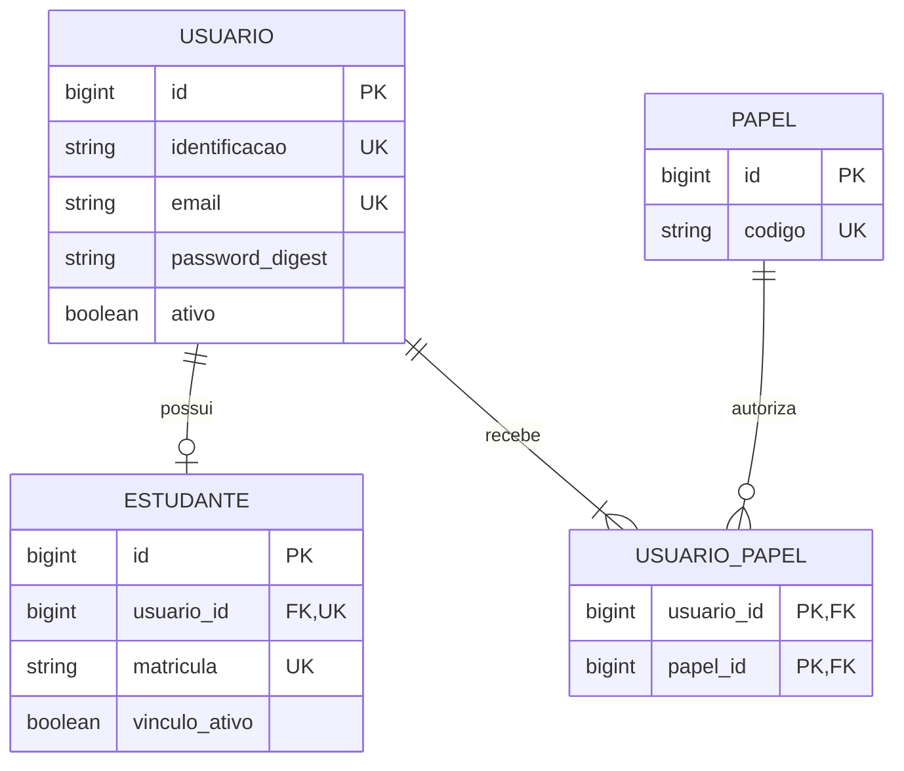
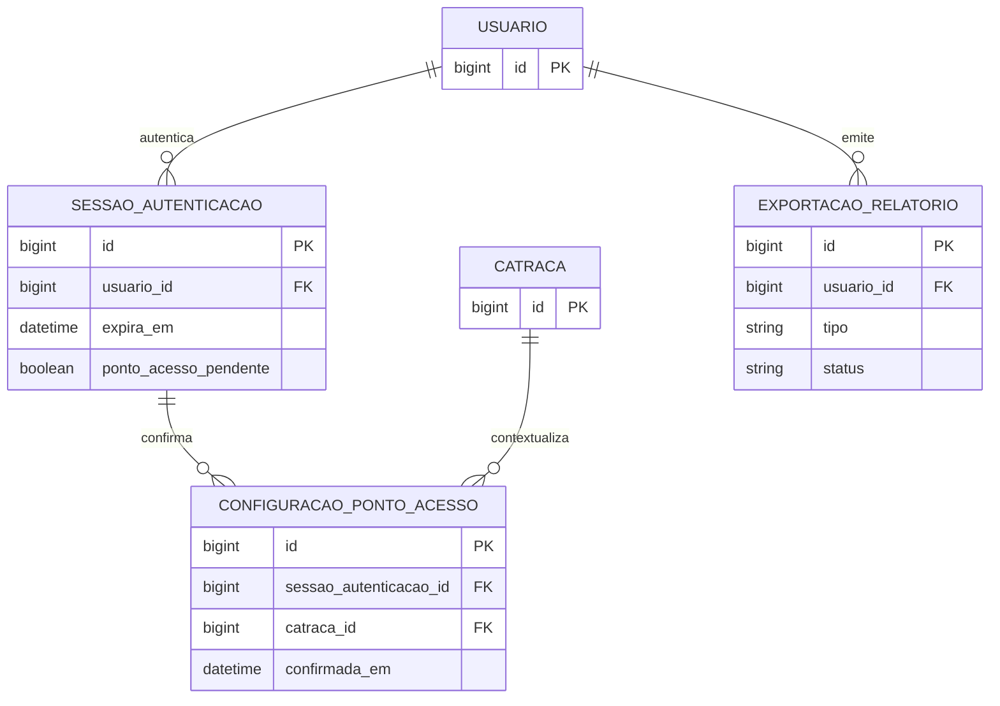
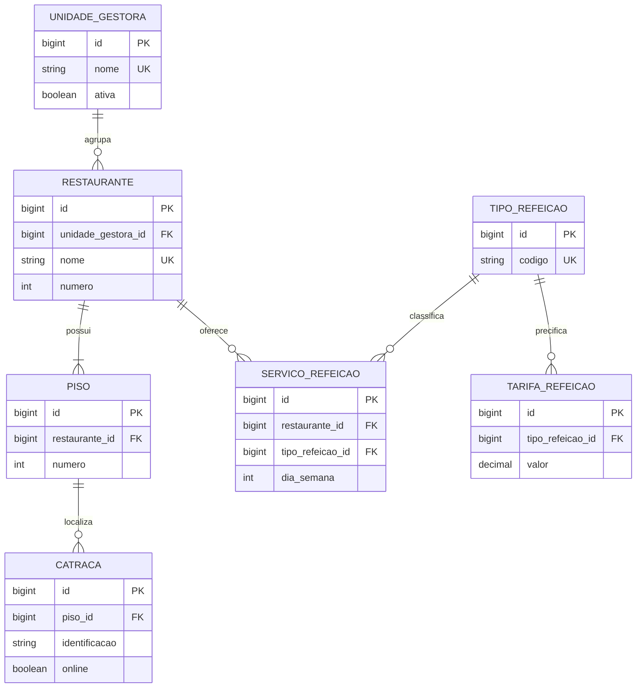
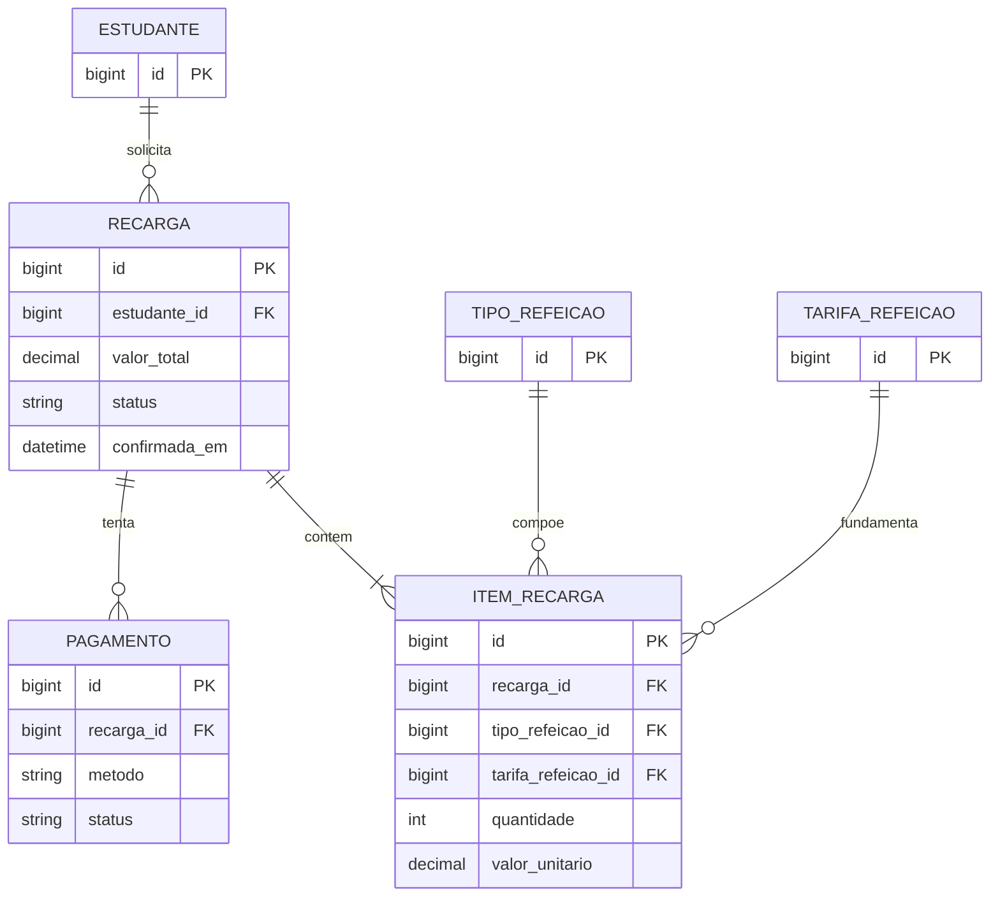
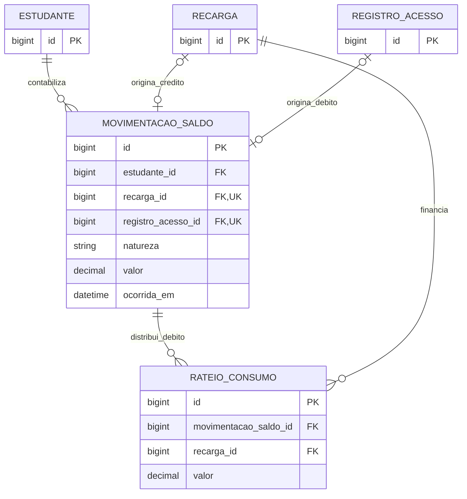
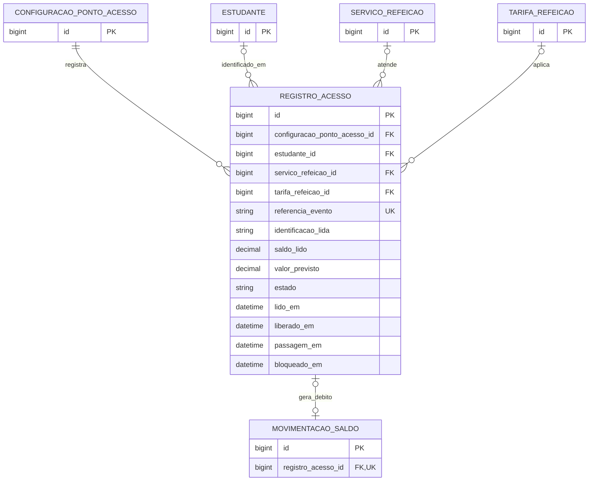
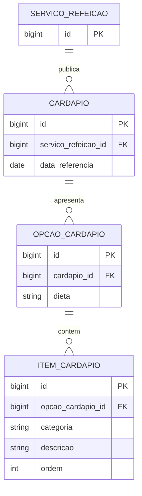

# Introdução

O UnB RU é um sistema de gerenciamento do Restaurante Universitário da Universidade de Brasília. O domínio reúne a conta do estudante, a compra de créditos, a operação de catracas, a gestão de restaurantes, a consulta de cardápios e a produção de relatórios para estudantes e administradores. Este relatório apresenta um modelo entidade-relacionamento lógico, com indicação de chaves e restrições para sua futura implementação em Ruby on Rails e banco relacional.

O documento segue as seções do template `ER-MyRottenPotatoes.tex`, disponibilizado em `TemplateRelatorioSprint1_1`: Introdução, Entidades Principais, Modelo Relacional UML e Considerações Finais. O diagrama utiliza a notação ER de pé de galinha, em vez da notação de classes UML do exemplo, conforme a possibilidade de utilizar Mermaid indicada no enunciado. O apêndice registra o uso de inteligência artificial na elaboração.

| Integrante | Matrícula | Papel na sprint |
|:---|:---|:---|
| Daniel Dezan Baby | 232046097 | Scrum Master |
| Leonardo Tome Sampaio | 222005448 | Product Owner |
| Luis Eduardo Curi Serra | 251033574 | Desenvolvedor |
| Tarsila Marques de Oliveira Alves | 242012029 | Desenvolvedora |
| Weldo Gonçalves da Silva Junior | 222014133 | Desenvolvedor |

**Base de requisitos.** Foram analisados os 12 arquivos em `features/`, a wiki do projeto, o arquivo `cardapio.json` e o enunciado `sprint1.pdf`. As referências F01 a F12 correspondem à numeração utilizada na wiki. O relatório descreve uma proposta de modelagem: as tabelas e os serviços aqui especificados ainda não constituem uma aplicação implementada.

**Limites e premissas.** Os requisitos especificam comportamentos, mas não resolvem todas as decisões de persistência. A separação de perfis, a política de consumo de créditos, o armazenamento de auditoria de exportações e o tratamento de concorrência são decisões propostas neste relatório e identificadas como tais. Os preços presentes nos cenários são dados de teste; o modelo mantém tarifas e valores históricos, sem escolher uma tarifa definitiva.

# Entidades Principais

## Convenções do modelo

Todas as entidades possuem `id` como chave primária do tipo `bigint`, exceto `UsuarioPapel`, cuja chave é o par de chaves estrangeiras. O sufixo `_id` identifica uma FK. As tabelas recebem os campos técnicos `created_at` e `updated_at` quando aplicáveis; eles não substituem os horários de negócio, como confirmação do pagamento e passagem na catraca.

Valores monetários usam `decimal(12,2)`, nunca ponto flutuante. Matrículas e identificações são textos, preservando zeros à esquerda. Datas e horas de eventos são armazenadas com referência temporal inequívoca em UTC e exibidas no fuso `America/Sao_Paulo`. Intervalos de datas do usuário incluem o primeiro e o último dia; sua consulta utiliza o início do primeiro dia até, sem incluir, o início do dia posterior ao último.

Nos atributos abaixo, **obrigatório** significa `NOT NULL`; **opcional** significa que `NULL` é permitido. A descrição de uma unicidade composta aplica-se à combinação dos campos. As entidades de apoio ampliam o modelo para atender aos cenários de erro e à auditoria, além dos fluxos felizes.

## 1. Usuario — identidade e credenciais

Centraliza os dados de autenticação de estudantes, funcionários e administradores, evitando credenciais duplicadas para uma pessoa com mais de um perfil.

- `id`: PK.
- `nome`: texto obrigatório, utilizado na identificação de relatórios e da conta.
- `identificacao`: texto obrigatório e único; login de funcionário sem impor formato numérico, conforme F04.
- `email`: texto obrigatório, normalizado e único sem diferenciar maiúsculas de minúsculas.
- `password_digest`: texto obrigatório contendo o hash da senha; a senha em texto não é persistida.
- `ativo`: booleano obrigatório; conta inativa não cria uma sessão válida.

**Relacionamentos:** um usuário possui zero ou um cadastro de estudante, zero ou muitas sessões, zero ou muitas emissões de relatório e um ou mais papéis associados após a conclusão do cadastro.

**Regras atendidas:** F01 e F04. O cadastro público cria somente o papel de estudante. A validação de domínio institucional aplica-se ao cadastro estudantil, sem inventar uma exigência equivalente para funcionários. O conjunto exato de domínios aceitos e a consulta que confirma vínculo ativo com a UnB precisam ser definidos pela equipe.

## 2. Papel — permissões por perfil

- `id`: PK.
- `codigo`: texto obrigatório e único, com os valores propostos `estudante`, `funcionario`, `administrador` e `administrador_geral`.
- `descricao`: texto obrigatório que explica o conjunto de permissões.

**Relacionamento:** um papel pode estar associado a nenhum ou muitos usuários por `UsuarioPapel`.

**Decisão proposta:** permitir múltiplos papéis evita interpretar uma conta exclusivamente estudantil como conta de funcionário. O administrador geral pode consultar o relatório administrativo e tem a permissão específica de F12. A atribuição de papéis é administrativa e não pode ser recebida do formulário de cadastro público.

## 3. UsuarioPapel — associação de autorização

- `usuario_id`: FK obrigatória para `Usuario`.
- `papel_id`: FK obrigatória para `Papel`.
- Chave primária composta por `(usuario_id, papel_id)`.

**Relacionamento:** resolve a associação N:N entre usuários e papéis, impedindo a atribuição duplicada do mesmo papel. A existência do cadastro de estudante deve ser coerente com o papel estudantil.

## 4. Estudante — vínculo universitário e conta

- `id`: PK.
- `usuario_id`: FK obrigatória e única para `Usuario`.
- `matricula`: texto obrigatório e único, com exatamente nove dígitos.
- `vinculo_ativo`: booleano obrigatório, resultante da validação do vínculo universitário.

**Relacionamentos:** cada estudante pertence a um usuário e pode possuir muitas recargas, leituras de identificação e movimentações financeiras.

**Saldo:** é calculado pela soma dos valores assinados de `MovimentacaoSaldo`. Uma conta nova tem saldo zero. Não existe uma segunda coluna de saldo independente neste modelo; uma futura otimização com saldo armazenado deve manter reconciliação com o extrato. Isso evita atualizar o saldo por uma cobrança ainda pendente.

## 5. SessaoAutenticacao — validade do acesso

- `id`: PK; `usuario_id`: FK obrigatória para `Usuario`.
- `token_digest`: texto obrigatório e único, representando um identificador de sessão sem armazenar o token utilizável.
- `autenticada_em` e `expira_em`: instantes obrigatórios, com expiração posterior à autenticação.
- `encerrada_em`: instante opcional; preenchido em logout ou revogação.
- `ponto_acesso_pendente`: booleano obrigatório, inicialmente verdadeiro na aplicação de controle.

**Relacionamentos:** uma sessão pertence a um usuário e possui zero ou muitas configurações confirmadas de ponto de acesso. Somente uma configuração pode estar vigente por sessão.

**Regras atendidas:** F04 e F05. Uma sessão é válida se não foi encerrada, não expirou e o usuário permanece ativo. O prazo de expiração não foi definido pelos cenários e permanece configurável. A reconfiguração pendente bloqueia operações mesmo que a configuração anterior ainda exista para auditoria.

## 6. ConfiguracaoPontoAcesso — contexto confirmado de operação

- `id`: PK; `sessao_autenticacao_id`: FK obrigatória para `SessaoAutenticacao`.
- `catraca_id`: FK obrigatória para `Catraca`.
- `confirmada_em`: instante obrigatório da confirmação válida.
- `finalizada_em`: instante opcional; quando preenchido, deve ser posterior ou igual à confirmação.

**Relacionamentos:** cada configuração pertence a uma sessão e a uma catraca; pode originar muitos registros de acesso. O funcionário é obtido pela sessão; o restaurante, pela catraca e seu piso.

**Regras atendidas:** F05 e F07. A escolha feita no formulário ainda não é uma configuração confirmada. Uma troca válida finaliza a configuração anterior e cria outra, sem reatribuir acessos antigos. Uma tentativa inválida não cria configuração nem substitui a anterior. Logout ou expiração tornam o contexto inutilizável, preservando seus registros de auditoria.

## 7. UnidadeGestora — agrupamento administrativo

- `id`: PK.
- `nome`: texto obrigatório e único.
- `ativa`: booleano obrigatório.

**Relacionamento:** uma unidade gestora possui zero ou muitos restaurantes; cada restaurante pertence a exatamente uma unidade. Permite o filtro de F09. “Campus Darcy Ribeiro” é a unidade padrão prevista na feature, identificada por cadastro, sem fixar seu ID no código.

## 8. Restaurante — unidade de atendimento

- `id`: PK; `unidade_gestora_id`: FK obrigatória para `UnidadeGestora`.
- `nome`: texto obrigatório, único no sistema segundo a validação de nome existente de F08.
- `numero`: inteiro obrigatório, positivo e único na unidade gestora; determina a ordenação de F09.
- `capacidade_refeicoes_hora`: inteiro obrigatório e maior que zero.
- `ativo`: booleano obrigatório.

**Relacionamentos:** cada restaurante possui um ou muitos pisos e zero ou muitos serviços de refeição. A quantidade de pisos é obtida pelos seus registros, evitando mantê-la duplicada.

**Regras atendidas:** F05, F08 e F09. A criação dos pisos e do restaurante é atômica. Não se pode remover um restaurante com catracas associadas; vínculos históricos também impedem exclusão física. Para cadastros com histórico, a proposta é desativar e preservar as referências. Essa política complementa os cenários e deve ser validada pelo grupo.

## 9. Piso — localização física

- `id`: PK; `restaurante_id`: FK obrigatória para `Restaurante`.
- `numero`: inteiro obrigatório e positivo.
- Unicidade composta `(restaurante_id, numero)`.

**Relacionamento:** um piso pertence a um restaurante e pode possuir zero ou muitas catracas. A seleção de um piso inexistente é rejeitada em F08. O piso não muda de restaurante depois de ser referenciado por uma catraca com histórico.

## 10. Catraca — equipamento de controle

- `id`: PK; `piso_id`: FK obrigatória para `Piso`.
- `identificacao`: texto obrigatório, como “Catraca 01” ou “CAT-01”.
- `ativa`: booleano obrigatório; permite desativação administrativa.
- `online`: booleano obrigatório; representa o estado operacional conhecido.
- `estado_verificado_em`: instante opcional da última verificação de conectividade.

**Relacionamentos:** cada catraca pertence a um piso e pode participar de muitas configurações de ponto de acesso. Os acessos históricos são encontrados pelas configurações.

**Unicidade:** a identificação é única por restaurante, inclusive entre pisos distintos. Uma validação de serviço deve consultar o restaurante do piso; em PostgreSQL, a garantia concorrente pode usar um gatilho que serialize cadastros pela linha do restaurante. Um índice apenas em `(piso_id, identificacao)` seria insuficiente para o cenário de identificação repetida em outro piso do mesmo restaurante.

**Regras atendidas:** F05, F07, F08 e F09. `ativa` e `online` representam conceitos distintos. Uma catraca em operação não pode ser removida; considera-se em operação a configuração vigente de uma sessão válida. Movê-la entre restaurantes com histórico é proibido nesta proposta, preservando o vínculo original dos registros.

## 11. TipoRefeicao — classificação do serviço

- `id`: PK.
- `codigo`: texto obrigatório e único: `cafe_da_manha`, `almoco` ou `jantar`.
- `nome`: texto obrigatório para exibição.

**Relacionamentos:** um tipo de refeição pode ter muitos serviços, tarifas e itens de recarga.

**Regras atendidas:** F02, F06, F09 e F10. Almoço e jantar permanecem tipos distintos para relatórios e horários. A interface pode oferecer um pacote “Almoço/Jantar”; nesta proposta, a compra resulta em crédito monetário, conforme o saldo descrito nos cenários. Não se presume um saldo de tickets restrito por tipo de refeição.

## 12. TarifaRefeicao — preço com vigência

- `id`: PK; `tipo_refeicao_id`: FK obrigatória para `TipoRefeicao`.
- `valor`: decimal obrigatório, maior que zero.
- `vigente_desde`: instante obrigatório; `vigente_ate`: instante opcional, posterior ao início quando informado.

**Relacionamentos:** uma tarifa pode ser utilizada por muitos itens de recarga e registros de acesso. Para um tipo, duas vigências não podem se sobrepor; o intervalo é fechado no início e aberto no fim.

**Decisão proposta:** a tarifa é institucional por tipo, pois F02 não escolhe restaurante para comprar créditos. Caso a equipe defina preços por restaurante ou categoria de estudante, o escopo tarifário precisará ser ampliado. O valor aplicado é copiado para o item ou acesso; alterar uma tarifa futura não recalcula transações passadas.

## 13. ServicoRefeicao — agenda de atendimento

- `id`: PK; `restaurante_id`: FK obrigatória para `Restaurante`; `tipo_refeicao_id`: FK obrigatória para `TipoRefeicao`.
- `dia_semana`: inteiro obrigatório de 0 a 6, com domingo igual a 0.
- `inicio` e `fim`: horários locais obrigatórios, com início anterior ao fim.
- `ativo`: booleano obrigatório.
- Unicidade composta `(restaurante_id, tipo_refeicao_id, dia_semana)`.

**Relacionamentos:** um serviço pode possuir muitos cardápios datados e muitos registros de acesso. Os horários de um restaurante no mesmo dia não podem se sobrepor.

**Regras atendidas:** F06 e F10. A refeição atual é determinada pelo restaurante, dia da semana e horário, usando início inclusivo e fim exclusivo. Os horários reais não estão definidos no material local; não são inventados como regra definitiva. Serviços que atravessem a meia-noite exigiriam extensão do modelo.

## 14. Recarga — pedido de compra de crédito

- `id`: PK; `estudante_id`: FK obrigatória para `Estudante`.
- `solicitada_em`: instante obrigatório.
- `valor_total`: decimal obrigatório e maior que zero, igual à soma dos itens.
- `status`: texto obrigatório: `pendente`, `confirmada`, `expirada` ou `cancelada`.
- `confirmada_em`: instante opcional, obrigatório apenas para recarga confirmada.

**Relacionamentos:** cada recarga possui um ou muitos itens e zero ou muitas tentativas de pagamento. Produz no máximo uma movimentação de crédito. Pode financiar muitos débitos por meio de rateios.

**Regras atendidas:** F02 e F03. O pedido e seus itens são salvos em uma transação. Um formulário com quantidades zeradas não produz pedido válido nem cobrança. A confirmação financeira é diferente da solicitação do estudante.

## 15. ItemRecarga — composição e preço da compra

- `id`: PK; `recarga_id`: FK obrigatória para `Recarga`.
- `tipo_refeicao_id`: FK obrigatória para `TipoRefeicao`; `tarifa_refeicao_id`: FK obrigatória para `TarifaRefeicao`.
- `quantidade`: inteiro obrigatório e maior que zero.
- `valor_unitario`: decimal obrigatório e maior que zero, preservado no momento da compra.
- Unicidade composta `(recarga_id, tipo_refeicao_id)`.

**Relacionamento:** cada item pertence a um pedido e referencia o tipo e a tarifa utilizados. O tipo da tarifa deve ser o mesmo do item. Subtotal é `quantidade × valor_unitario`; não requer coluna independente.

**Exemplo de F02:** cinco cafés a R$ 2,50 e dez almoços/jantares a R$ 4,50 totalizam R$ 57,50. A categoria agrupada da interface deve ser convertida de maneira documentada para os itens internos; o crédito final é monetário e não impede seu uso no jantar.

## 16. Pagamento — tentativa e confirmação pelo provedor

- `id`: PK; `recarga_id`: FK obrigatória para `Recarga`.
- `metodo`: texto obrigatório: `pix` ou `cartao_credito`, métodos aceitos por F02.
- `status`: texto obrigatório: `pendente`, `confirmado`, `recusado` ou `expirado`.
- `referencia_provedor`: texto opcional, único quando informado; torna-se obrigatório quando a cobrança é emitida no provedor.
- `valor_solicitado`: decimal obrigatório e positivo; deve coincidir com o pedido.
- `valor_confirmado`: decimal opcional; obrigatório e igual ao solicitado na confirmação válida.
- `criado_em`: instante obrigatório; `expira_em` e `confirmado_em`: instantes opcionais conforme método e estado.
- `pix_copia_cola`: texto opcional; preenchido quando o PIX é emitido. O QR Code pode ser renderizado a partir desse conteúdo.

**Relacionamento:** um pedido pode ter mais de uma tentativa, mas somente uma confirmação aceita. Um índice único parcial em `recarga_id` para `status = 'confirmado'` impede dois pagamentos confirmados para o mesmo pedido. A referência do provedor identifica notificações repetidas.

**Regras atendidas:** F02 e F09. O PIX expira dez minutos após a criação da cobrança. A confirmação deve ser verificada no servidor, não deduzida do cronômetro ou do retorno visual do navegador. Não se armazenam número completo do cartão ou CVV. A reação a um pagamento efetivamente recebido depois da expiração necessita definição do provedor e da equipe; não se credita silenciosamente uma cobrança expirada.

## 17. RegistroAcesso — toda leitura na catraca

- `id`: PK.
- `configuracao_ponto_acesso_id`: FK obrigatória para o contexto confirmado da operação.
- `estudante_id`: FK opcional para `Estudante`, ausente em leitura desconhecida.
- `servico_refeicao_id` e `tarifa_refeicao_id`: FKs opcionais; obrigatórias para autorização válida de uma refeição.
- `identificacao_lida`: texto obrigatório, admitindo texto vazio para auditar a leitura inválida.
- `lido_em`: instante obrigatório da leitura; `saldo_lido`: decimal opcional, ausente para identificação desconhecida.
- `valor_previsto`: decimal opcional, positivo quando a tarifa foi identificada.
- `estado`: texto obrigatório: `negado`, `aguardando_passagem`, `realizado` ou `expirado`.
- `motivo_negacao`: texto opcional, obrigatório no estado `negado`.
- `liberado_em`, `passagem_em` e `bloqueado_em`: instantes opcionais, sujeitos às regras de estado.
- `referencia_evento`: texto obrigatório e único, utilizado para reconhecer repetição de eventos do equipamento.

**Relacionamentos:** cada leitura pertence a um contexto confirmado. Pode referenciar um estudante, um serviço e uma tarifa. Uma passagem realizada possui exatamente uma movimentação de débito; as demais leituras não possuem débito.

**Regras atendidas:** F06 e F07. `catraca_liberada = S` deriva de `liberado_em` preenchido; `acesso_realizado = S` deriva de `estado = realizado`. Essas projeções reproduzem os campos exigidos pelo histórico, sem manter booleanos redundantes que possam contradizer os timestamps. O saldo lido é uma fotografia e não o saldo atual recalculado posteriormente.

## 18. MovimentacaoSaldo — extrato financeiro definitivo

- `id`: PK; `estudante_id`: FK obrigatória para `Estudante`.
- `recarga_id`: FK opcional e única para `Recarga`.
- `registro_acesso_id`: FK opcional e única para `RegistroAcesso`.
- `natureza`: texto obrigatório: `credito_recarga` ou `debito_refeicao`.
- `valor`: decimal obrigatório, positivo no crédito e negativo no débito.
- `ocorrida_em`: instante obrigatório, igual à confirmação do crédito ou à passagem da refeição.

**Relacionamentos:** uma movimentação pertence a um estudante e possui exatamente uma origem: recarga ou acesso. Um débito pode ser dividido em muitos rateios de consumo.

**Regras atendidas:** F02, F03, F06 e F11. Um `CHECK` garante a exclusividade das origens e a coerência entre natureza e sinal. Créditos exigem recarga confirmada; débitos exigem acesso realizado. O estudante da movimentação deve coincidir com o estudante da origem. Não se apagam lançamentos para alterar saldo. Estornos e chargebacks exigiriam novos tipos de lançamento e não foram especificados nesta sprint.

## 19. RateioConsumo — origem dos recursos de uma refeição

- `id`: PK; `movimentacao_saldo_id`: FK obrigatória para uma movimentação de débito.
- `recarga_id`: FK obrigatória para uma recarga confirmada do mesmo estudante.
- `valor`: decimal obrigatório e maior que zero.
- Unicidade composta `(movimentacao_saldo_id, recarga_id)`.

**Relacionamentos:** uma recarga pode financiar muitos débitos e um débito pode consumir recursos de muitas recargas. A associação N:N é resolvida por esta entidade.

**Decisão proposta para F09:** consumir créditos confirmados mais antigos primeiro, pelo critério FIFO. A soma dos rateios de um débito deve ser igual ao seu valor absoluto; a soma consumida de uma recarga não pode exceder seu crédito. Isso permite atribuir uma refeição ao PIX e/ou ao cartão de origem, mesmo quando a recarga ocorreu em outra data. Somar recargas do dia e chamar o resultado de arrecadação das refeições do dia produziria números incorretos.

## 20. Cardapio — publicação por data e serviço

- `id`: PK; `servico_refeicao_id`: FK obrigatória para `ServicoRefeicao`.
- `data_referencia`: data obrigatória, cujo dia da semana deve coincidir com o serviço.
- Unicidade composta `(servico_refeicao_id, data_referencia)`.

**Relacionamento:** cada cardápio pertence a um serviço em uma data e possui zero ou muitas opções de dieta. Um cardápio não é a refeição consumida; é a informação disponibilizada ao estudante.

**Regras atendidas:** F10. O JSON semanal existente pode fornecer dados iniciais para uma semana selecionada, gerando publicações datadas. Não se presume que o mesmo cardápio se repita indefinidamente nem que o arquivo contenha horários de funcionamento.

## 21. OpcaoCardapio — alternativa alimentar

- `id`: PK; `cardapio_id`: FK obrigatória para `Cardapio`.
- `dieta`: texto obrigatório: `padrao`, `ovolactovegetariana` ou `vegetariana_estrita`.
- Unicidade composta `(cardapio_id, dieta)`.

**Relacionamento:** cada opção possui zero ou muitos itens. A opção ausente ou sem itens deve ser apresentada como indisponível, conforme F10. Os demais grupos continuam visíveis.

## 22. ItemCardapio — composição da opção

- `id`: PK; `opcao_cardapio_id`: FK obrigatória para `OpcaoCardapio`.
- `categoria`: texto obrigatório, como bebida, salada, prato principal, acompanhamento ou sobremesa.
- `descricao`: texto obrigatório e não vazio.
- `ordem`: inteiro obrigatório e positivo, único dentro da opção.

**Relacionamento:** um item pertence a exatamente uma opção alimentar. A importação do JSON distribui itens comuns entre as opções e associa os complementos/pratos específicos à dieta correspondente. Campo `null` ou lista vazia não deve gerar item de texto vazio.

## 23. ExportacaoRelatorio — emissão e contexto da auditoria

- `id`: PK; `usuario_id`: FK obrigatória para o emissor.
- `tipo`: texto obrigatório: `extrato_estudante` ou `operacao_global`.
- `formato`: texto obrigatório: `pdf` ou `csv`, respeitando a disponibilidade de cada feature.
- `filtros` e `agrupamentos`: objetos JSON obrigatórios, com estrutura validada para cada relatório.
- `solicitada_em`: instante obrigatório; `emitida_em`: instante opcional.
- `status`: texto obrigatório: `processando`, `concluida`, `sem_dados` ou `falhou`.
- `quantidade_registros`: inteiro opcional e não negativo; `total_debitos` e `total_creditos`: decimais opcionais e não negativos.
- `arquivo_chave` e `arquivo_sha256`: textos opcionais; somente preenchidos após geração completa.
- `assinatura_status`: texto obrigatório: `nao_aplicavel`, `pendente`, `assinada` ou `falhou`.

**Relacionamento:** uma emissão pertence a um usuário. O estudante de F11 é derivado do usuário autenticado, nunca escolhido livremente em um filtro recebido do navegador.

**Decisão proposta para F09, F11 e F12:** persistir metadados de emissão permite explicar quem exportou, quando, com quais filtros e agrupamentos. Os dados do documento devem ser obtidos de uma consulta consistente, incluindo todas as páginas, e o arquivo final é identificado por hash. O hash detecta alteração do arquivo, mas não é assinatura digital. A assinatura exigida no cenário de F11 requer mecanismo criptográfico e certificado a definir; o documento não pode ser rotulado como assinado antes desse processo.

# Modelo Relacional UML

A visão geral apresenta o esquema completo em um único diagrama, com as 23 entidades, todos os atributos do dicionário e os 30 relacionamentos; como a figura é vetorial, seus detalhes podem ser ampliados no PDF. Para manter a legibilidade, o mesmo esquema é detalhado em sete visões parciais. Entidades repetidas entre as figuras representam as mesmas tabelas. As visões parciais exibem chaves e atributos centrais; o dicionário anterior define os demais atributos e restrições.

**Legenda:** `||` significa exatamente um; `o|`, zero ou um; `o{`, zero ou muitos; `|{`, um ou muitos. `PK` indica chave primária, `FK` chave estrangeira e `UK` chave única. Na visão geral, a última coluna das entidades anota unicidades compostas ou parciais e restrições entre relacionamentos que a cardinalidade não expressa, como o XOR entre as origens de uma movimentação. As relações opcionais entre acesso, tarifa e estudante permitem registrar leituras rejeitadas sem inventar um estudante válido.

## Visão geral — Modelo completo

```mermaid
---
config:
  layout: elk
  elk:
    nodePlacementStrategy: NETWORK_SIMPLEX
---
erDiagram
    %% Identidade, papéis, sessão e emissão (visões 1 e 2)
    USUARIO ||--o| ESTUDANTE : possui
    USUARIO ||--|{ USUARIO_PAPEL : recebe
    PAPEL ||--o{ USUARIO_PAPEL : autoriza
    USUARIO ||--o{ SESSAO_AUTENTICACAO : autentica
    USUARIO ||--o{ EXPORTACAO_RELATORIO : emite
    SESSAO_AUTENTICACAO ||--o{ CONFIGURACAO_PONTO_ACESSO : confirma
    CATRACA ||--o{ CONFIGURACAO_PONTO_ACESSO : contextualiza

    %% Leitura, autorização e passagem (visão 6)
    CONFIGURACAO_PONTO_ACESSO ||--o{ REGISTRO_ACESSO : registra
    ESTUDANTE o|--o{ REGISTRO_ACESSO : identificado_em
    SERVICO_REFEICAO o|--o{ REGISTRO_ACESSO : atende
    TARIFA_REFEICAO o|--o{ REGISTRO_ACESSO : aplica

    %% Extrato e origem dos recursos consumidos (visão 5)
    ESTUDANTE ||--o{ MOVIMENTACAO_SALDO : contabiliza
    RECARGA o|--o| MOVIMENTACAO_SALDO : origina_credito
    REGISTRO_ACESSO o|--o| MOVIMENTACAO_SALDO : origina_debito
    MOVIMENTACAO_SALDO ||--o{ RATEIO_CONSUMO : distribui_debito
    RECARGA ||--o{ RATEIO_CONSUMO : financia

    %% Compra e pagamento (visão 4)
    ESTUDANTE ||--o{ RECARGA : solicita
    RECARGA ||--|{ ITEM_RECARGA : contem
    TIPO_REFEICAO ||--o{ ITEM_RECARGA : compoe
    TARIFA_REFEICAO ||--o{ ITEM_RECARGA : fundamenta
    RECARGA ||--o{ PAGAMENTO : tenta

    %% Estrutura física e oferta de refeições (visão 3)
    UNIDADE_GESTORA ||--o{ RESTAURANTE : agrupa
    RESTAURANTE ||--|{ PISO : possui
    PISO ||--o{ CATRACA : localiza
    RESTAURANTE ||--o{ SERVICO_REFEICAO : oferece
    TIPO_REFEICAO ||--o{ SERVICO_REFEICAO : classifica
    TIPO_REFEICAO ||--o{ TARIFA_REFEICAO : precifica

    %% Cardápios e alternativas alimentares (visão 7)
    SERVICO_REFEICAO ||--o{ CARDAPIO : publica
    CARDAPIO ||--o{ OPCAO_CARDAPIO : apresenta
    OPCAO_CARDAPIO ||--o{ ITEM_CARDAPIO : contem

    USUARIO {
        bigint id PK
        string nome
        string identificacao UK
        string email UK
        string password_digest
        boolean ativo
    }
    PAPEL {
        bigint id PK
        string codigo UK
        string descricao
    }
    USUARIO_PAPEL {
        bigint usuario_id PK, FK
        bigint papel_id PK, FK
    }
    ESTUDANTE {
        bigint id PK
        bigint usuario_id FK, UK
        string matricula UK
        boolean vinculo_ativo
    }
    SESSAO_AUTENTICACAO {
        bigint id PK
        bigint usuario_id FK
        string token_digest UK
        datetime autenticada_em
        datetime expira_em
        datetime encerrada_em
        boolean ponto_acesso_pendente
    }
    CONFIGURACAO_PONTO_ACESSO {
        bigint id PK
        bigint sessao_autenticacao_id FK "uma vigente por sessão"
        bigint catraca_id FK
        datetime confirmada_em
        datetime finalizada_em
    }
    UNIDADE_GESTORA {
        bigint id PK
        string nome UK
        boolean ativa
    }
    RESTAURANTE {
        bigint id PK
        bigint unidade_gestora_id FK
        string nome UK
        int numero "único na unidade gestora"
        int capacidade_refeicoes_hora
        boolean ativo
    }
    PISO {
        bigint id PK
        bigint restaurante_id FK
        int numero "único no restaurante"
    }
    CATRACA {
        bigint id PK
        bigint piso_id FK
        string identificacao "única no restaurante"
        boolean ativa
        boolean online
        datetime estado_verificado_em
    }
    TIPO_REFEICAO {
        bigint id PK
        string codigo UK
        string nome
    }
    TARIFA_REFEICAO {
        bigint id PK
        bigint tipo_refeicao_id FK
        decimal valor
        datetime vigente_desde
        datetime vigente_ate
    }
    SERVICO_REFEICAO {
        bigint id PK
        bigint restaurante_id FK
        bigint tipo_refeicao_id FK
        int dia_semana "único por restaurante e tipo"
        time inicio
        time fim
        boolean ativo
    }
    RECARGA {
        bigint id PK
        bigint estudante_id FK
        datetime solicitada_em
        decimal valor_total
        string status
        datetime confirmada_em
    }
    ITEM_RECARGA {
        bigint id PK
        bigint recarga_id FK
        bigint tipo_refeicao_id FK "único na recarga"
        bigint tarifa_refeicao_id FK "do mesmo tipo do item"
        int quantidade
        decimal valor_unitario
    }
    PAGAMENTO {
        bigint id PK
        bigint recarga_id FK "um confirmado por recarga"
        string metodo
        string status
        string referencia_provedor UK
        decimal valor_solicitado
        decimal valor_confirmado
        datetime criado_em
        datetime expira_em
        datetime confirmado_em
        string pix_copia_cola
    }
    REGISTRO_ACESSO {
        bigint id PK
        bigint configuracao_ponto_acesso_id FK
        bigint estudante_id FK
        bigint servico_refeicao_id FK "do restaurante da catraca"
        bigint tarifa_refeicao_id FK "do tipo do serviço"
        string referencia_evento UK
        string identificacao_lida
        datetime lido_em
        decimal saldo_lido
        decimal valor_previsto
        string estado
        string motivo_negacao
        datetime liberado_em
        datetime passagem_em
        datetime bloqueado_em
    }
    MOVIMENTACAO_SALDO {
        bigint id PK
        bigint estudante_id FK "igual ao da origem"
        bigint recarga_id FK, UK "XOR registro_acesso_id"
        bigint registro_acesso_id FK, UK "XOR recarga_id"
        string natureza
        decimal valor
        datetime ocorrida_em
    }
    RATEIO_CONSUMO {
        bigint id PK
        bigint movimentacao_saldo_id FK "somente débito"
        bigint recarga_id FK "única no débito; mesmo estudante"
        decimal valor
    }
    CARDAPIO {
        bigint id PK
        bigint servico_refeicao_id FK
        date data_referencia "única no serviço"
    }
    OPCAO_CARDAPIO {
        bigint id PK
        bigint cardapio_id FK
        string dieta "única no cardápio"
    }
    ITEM_CARDAPIO {
        bigint id PK
        bigint opcao_cardapio_id FK
        string categoria
        string descricao
        int ordem "única na opção"
    }
    EXPORTACAO_RELATORIO {
        bigint id PK
        bigint usuario_id FK
        string tipo
        string formato
        json filtros
        json agrupamentos
        datetime solicitada_em
        datetime emitida_em
        string status
        int quantidade_registros
        decimal total_debitos
        decimal total_creditos
        string arquivo_chave
        string arquivo_sha256
        string assinatura_status
    }
```

## Visão 1 — Identidade e papéis

## Visão 2 — Sessão, ponto de acesso e emissão

## Visão 3 — Estrutura física e oferta de refeições

## Visão 4 — Compra e pagamento

## Visão 5 — Extrato e origem dos recursos consumidos

## Visão 6 — Leitura, autorização e passagem

## Visão 7 — Cardápios e alternativas alimentares

# Considerações Finais

O modelo cobre as 12 funcionalidades da primeira sprint com 23 entidades e 30 relacionamentos, apresentados na visão geral e detalhados nas sete visões parciais. Ao separar solicitação de recarga, confirmação de pagamento, leitura na catraca e passagem efetiva, e ao registrar a origem de cada lançamento, o esquema sustenta o extrato do estudante, o histórico das catracas e os relatórios globais sem gerar créditos ou débitos indevidos. Antes da implementação, o grupo ainda precisa definir a política de tarifas, o critério de consumo dos créditos e o mecanismo de assinatura digital dos relatórios.

# Apêndice — Uso de inteligência artificial

Este relatório, sua proposta de modelo ER e os diagramas Mermaid foram elaborados com apoio do **OpenAI Codex**. A estratégia utilizada foi a leitura do enunciado e do template LaTeX fornecidos pelo usuário, análise da wiki e dos 12 arquivos BDD, extração dos relacionamentos, levantamento de restrições e comparação das regras entre funcionalidades.

Foi utilizada a skill **plugin-management** para procurar uma integração com Figma após a tentativa de leitura do protótipo pela web. A integração não estava conectada durante a elaboração, portanto não se afirma ter inspecionado os frames. Não foram utilizados agentes paralelos. As entidades auxiliares e as decisões propostas estão identificadas para que o grupo possa revisá-las e explicar sua finalidade antes da entrega.

A visão geral do modelo foi elaborada posteriormente com apoio do **Claude Code** (Anthropic, modelo Claude Opus 5.5), a pedido de um integrante do grupo, que definiu a tarefa e revisou o resultado. A estratégia foi a seguinte: a IA leu o dicionário de dados e as sete visões, reuniu as 23 entidades com todos os atributos do dicionário e os 30 relacionamentos correspondentes às chaves estrangeiras, e eliminou um relacionamento duplicado entre as visões 5 e 6, que representavam a mesma chave estrangeira com rótulos diferentes. As anotações da última coluna foram extraídas do dicionário e das regras de integridade do relatório, sem acrescentar regras novas. Também não foram criadas chaves estrangeiras deriváveis por outros caminhos.

A verificação foi automatizada por scripts auxiliares, que não fazem parte do repositório. Um deles comparou o diagrama com o dicionário e com as sete visões: entidades, atributos, chaves, obrigatoriedade e unicidade das chaves estrangeiras e as cardinalidades resultantes. Esse script foi testado com erros inseridos de propósito. Outro mediu a legibilidade de 126 alternativas de layout do Mermaid, contando arestas sobre marcadores de cardinalidade, sobre caixas ou sobre rótulos e cruzamentos entre arestas; a alternativa adotada não apresenta os três primeiros problemas e tem quatro cruzamentos. A IA ajustou ainda o script `gerar_relatorio.py` para incluir a visão geral sem renumerar as demais figuras, ajustar o PDF do diagrama a uma página e manter a regra de quebra de identificadores longos independentemente dos pacotes LaTeX instalados.

Na mesma ferramenta e a pedido do grupo, o relatório foi depois enxugado para a entrega: foram retirados a seção de normalização e os apêndices de integridade e de rastreabilidade, as considerações finais foram condensadas em um parágrafo, e os apêndices do spike de views Rails e das divergências entre cenários foram movidos, sem alteração, para o arquivo `referencia-spike-views-e-decisoes.md`. Não foram utilizados agentes paralelos.

# Referências

- Enunciado da Sprint 1: `sprint1.pdf`, especialmente a seção “Segunda etapa”.
- Template fornecido: `TemplateRelatorioSprint1_1/ER-MyRottenPotatoes.tex`.
- Wiki do projeto: `wiki/Home.md`.
- Especificações de aceitação: os 12 arquivos em `features/`.
- Dados de cardápio: `cardapio.json`.
- Protótipo indicado no enunciado: [UnB RU no Figma](https://www.figma.com/design/Clozp7Rj1jOBz6l7LoT44t/UnB-RU---Engenharia-de-Software?node-id=0-1). Conteúdo visual não acessado.
- [Mermaid — Entity Relationship Diagrams](https://mermaid.js.org/syntax/entityRelationshipDiagram.html).
